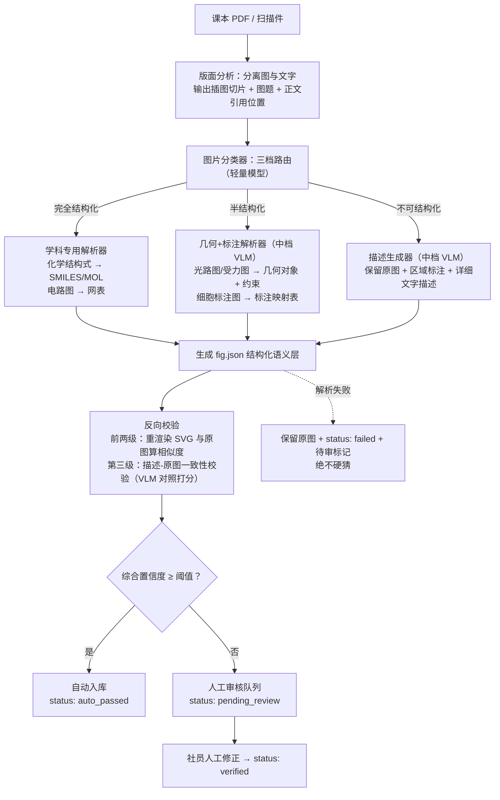

# Alethic Insight Document（.aid）插图解析方式与目标模态设计

> 核心立场：PDF 等传统格式为人眼和打印设计，插图以像素存储；AI 原生格式为大模型设计，插图应以结构化语义（文本模态）作为主模态存储，原图仅作兜底与校验基准。本方案围绕这一立场展开，并针对物理、化学、生物课本插图给出具体的分类、解析与存储设计。

## 一、题意理解
> 本人理解：阅读完此题，我先用自己的话翻译一下本题。1、"面向 AI 原生的文档格式"很好理解，比如目前常用的 pdf、word，人可以一眼看出其表达的内容；现在我们需要设计一个给 AI 大模型阅读的文档格式，.aid 就是这个格式的后缀，和我现在写的 markdown（.md）、word（.docx）是同一类东西。2、三小科（物理、化学、生物）的插图太杂太难，我们需要设计一个方案让 AI 看懂，也就是把光路图、细胞结构图等以一种便于大模型理解的格式储存起来。3、我们需要设计解析方式，也就是搞清楚怎么把课本里的插图读出来、拆明白。4、然后找到"目标模态"：所谓模态即信息的载体形式，文字、图片、音频都是模态；我要思考插图信息最终转成哪种形式存储起来——是文字，还是图片。所以，我们要在搞清"读者是谁"的前提下，再做进一步打算。

> 本人理解：换个角度想，此题其实就是一个模态对齐的取舍：把插图从视觉模态对齐到语言模态。至于对齐，我的理解是——大语言模型是由文本喂出来的，图片对于大模型来说是一种外语，我们需要把它翻译成文本；翻译得好不好，就是对齐得好不好。这与本题的考点相通，也是"偏对齐"的由来。我们选取把图片转为语言模态，理由是语言空间是大模型（LLM）理解力最强的空间。那为什么不直接用 VLM（视觉语言模型）干活？因为那是把对齐压力全压给模型侧：每次调用都要花钱，面对密集的理科精细图，识别精度不稳定，还可能出现幻觉；要稳定就得自己训练一个足够强的 VLM，学生社团更负担不起。所以我的方案是把对齐做在数据侧：把图解析成结构化文本，对齐到大模型最擅长的语言空间，一次解析、永久复用。对齐确实会对原图原意产生一部分损伤——图片是没有文字可以完全等价的——所以图片也要保留，再采用反向校验给对齐质量兜底。这样在效率、准确性、性价比三个维度上取得综合最优。

> 本人理解：为什么我要使用反向校验？解析对不对，我要让机器自己看，而不是让人看。把解析结果渲染回图片，和原图对比：不像就一定错、打回重做；像，才允许进入下一步，形成质量闭环。

**传统格式是"人眼原生"的。** PDF 与扫描课本的设计目标是纸质打印与人眼阅读：版面是视觉排版的结果，插图本质上是一张位图。人眼看到凸透镜光路图，能瞬间理解"这是一条过焦点的入射光线"；但对模型而言，位图只是一堆像素矩阵，每次使用都要重新"看图理解"，理解结果不稳定、不可检索、不可复用。

**AI 原生格式是"模型原生"的，读者首先是模型。** 大模型的原生模态是文本与结构化符号。一旦明确"读者是模型"这一前提，插图的设计目标就发生了根本变化：

> 本人理解：对于 AI，插图应当是语义（json）。json 是一种带结构的纯文本数据格式，和 md、html 一样都是纯文本；json 专门给程序读，结构清清楚楚，任何语言都能一行代码读进来。插图不该以"照片"形式存，应该以"结构化的文字描述"形式存——图片只是渲染出来给人看的，语义（json）才是本体。语义是不变的核心，各种形式只是它的外壳。

- **主模态必须是模型零成本读取的文本。** 插图的信息应被"翻译"成结构化语义（实体、关系、约束），模型读 JSON 即可理解图的内容，无需每次调用视觉模型重新识图。
- **语义必须显式。** 人眼能从像素中"脑补"的关系（如"像与物关于透镜分居两侧"），必须被写成明确的字段，否则对模型而言不存在。
- **正确性必须可校验。** 结构化描述一旦出错，下游所有引用都会被污染。因此结构化语义必须能反向重新渲染，与原图比对，形成闭环校验；原图作为不可篡改的事实基准保留。

> ⭐【核心机制·反向校验】这里确立了全案的设计公理：结构化语义必须能重新渲染并与原图比对——"可校验"是语义层敢当主模态的前提。

由此得出本方案的总原则：**结构化语义是"给模型读的正文"，原图是"给人兜底、给机器校验的事实备份"，二者不是二选一，而是主从关系。**

## 二、.aid 格式规范

.aid 文件是一个 ZIP 容器，内部结构如下：

```
chapter3.aid (ZIP)
├── manifest.json          # 清单：格式版本、文件列表、各文件哈希、插图统计
├── content.md             # 正文（Markdown），插图以  引用
├── figures/
│   ├── fig_001.png        # 原图层：兜底 + 校验基准
│   ├── fig_001.svg        # 可执行图源层：由语义重新渲染，可再编辑
│   └── fig_001.json       # 结构化语义层：主模态，给 AI 读
│   └── ...
└── meta/
    ├── pipeline.json      # 解析管线版本、参数、模型版本记录
    └── review.log         # 人工审核记录（谁、何时、改了什么）
```

设计决策与理由：

- **正文用纯文本 Markdown（content.md）。** 三个理由：其一，纯文本可直接纳入 Git 版本管理，`git diff` 能精确看到"第几段文字、哪个图的哪条语义被修改"，二进制格式做不到；其二，模型读取零成本，无需任何解析器；其三，Markdown 是事实标准，人人会写、处处能渲染。需要说明：Git 管理的是**解压态的源目录**（content.md 与各 fig.json），ZIP 仅作为分发与归档的打包单元——版本管理作用于源文件，与最终的 .aid 打包形态并不矛盾。
- **插图三件套同名不同后缀（fig_001.png/.svg/.json）。** 正文引用写全路径 ``，任何标准 Markdown 渲染器都能直接打开，无需自研阅读器；模型读取语义时按同名约定取 fig_001.json，无需写进正文。命名约定代替复杂的索引文件，简单即可靠。
- **manifest.json 记录哈希，且哈希与修改流程配套。** 合法修改（如人工修正 fig.json）完成后须同步重新生成 manifest，并在 review.log 留痕；此后任何**未经留痕的**改动都会导致哈希不匹配而暴露。由此可回答"这份语义是谁在什么版本下产出的、是否被人工确认过"，保证可追溯性。
- **容器用 ZIP，不发明轮子。** ZIP 是成熟标准：操作系统自带解压，Python `zipfile`、各语言标准库均可读写，无需自研解析器。学生社团没有维护私有二进制格式的能力，选择"无聊但可靠"的技术是正确取舍。同时单个 .aid 自包含，拷走即是一份完整文档。
>本人理解：选ZIP是因为他足够成熟，照着走不会错。

## 三、插图分类学

物理、化学、生物课本插图浩如烟海，用同一条管线处理必然失败。按**可结构化程度**（即"图的语义能否被无损或近似无损地写成符号"）分为三档，每档对应不同的解析器与目标模态深度：

> 本人理解：和刚开始说的一样，不是所有的图都适合转为文字：能精确写下来的就写成字，写不下来的就保留图片和对图片的描述。

| 档位 | 定义 | 真实课本例子 | 结构化产物 |
|---|---|---|---|
| **完全结构化** | 图本身就是符号系统的图形化，存在成熟的无损文本表示 | 化学结构式（人教版高中化学必修二，乙醇的结构式与结构简式）；电路图（人教版九年级物理，串联/并联电路）；平面几何图（人教版初中数学，全等三角形证明配图） | SMILES/MOL、电路网表（节点-元件-连接关系）、几何对象与约束（点、线、角、全等/平行关系） |
| **半结构化** | 图由规范的几何元素与标注构成，语义可大部分结构化，但布局、示意性细节有损 | 物理光路图（人教版八年级物理，凸透镜成像光路）；受力分析图（高中物理必修一，斜面上物块受力分析）；生物细胞标注图（人教版高中生物必修一，动植物细胞亚显微结构模式图） | 几何对象+物理约束+标注映射表；示意性外观由 SVG 图层保留 |
| **不可结构化** | 图的信息在连续纹理与现象细节中，不存在无损符号表示 | 显微照片（人教版高中生物必修一，线粒体/叶绿体电镜照片、洋葱表皮细胞质壁分离实验照片）；化学实验现象照片（钠与水反应、焰色试验的火焰颜色） | 不做强行结构化：保留原图 + 区域标注 + 详细文字描述 |

需要特别说明一类容易误判的图：**球棍模型等承载三维构型信息的图不属于完全结构化档**。SMILES 是一维字符串，只编码原子的连接关系，不编码三维坐标，从球棍模型转 SMILES 恰恰是有损的。此类图按半结构化处理，三维信息需另存坐标数据（如 MOL 文件的坐标块）。

**为什么按"可结构化程度"而不是按学科分类？** 因为解析难度由图的信息形态决定，而非由学科决定：生物课本里既有完全可结构化的细胞模式标注图，也有完全不可结构化的电镜照片。按可结构化程度分类，才能让每张图路由到与其难度匹配的解析器，这是后文管线"分级调用模型"的基础。

## 四、目标模态设计

每张插图以**三层**存储，职责分明：

1. **结构化语义层（fig.json）——主模态，给 AI 读。** 图的语义被显式写成实体与关系，是模型理解、检索、推理、出题的默认入口；原图同时保留，供多模态模型复核与校验。
2. **可执行图源层（SVG）——可重新渲染。** 由 fig.json 生成，供人阅读、排版、二次编辑；同时也是反向校验的产物——SVG 与原图越像，说明语义越忠实。
3. **原图层（PNG/JPEG）——兜底 + 校验基准。** 从课本中切出的原始位图，永不修改。语义层的任何疑点都可以回溯到它；未来更强的解析模型出现时，可以基于原图重新解析升级。

> ⭐【核心机制·反向校验】SVG 层是反向校验的物质载体：它完全由 fig.json 生成，因此"SVG 与原图有多像"就能直接度量语义层有多忠实。

注：第三档（不可结构化）图的 SVG 层是"原图 + 标注叠加层"，而非从语义重新渲染——连续纹理无法从文字再生。承认这一表示极限，正是分层设计诚实性的体现。

fig.json 的字段级设计：

| 字段 | 类型 | 说明 | 为什么需要 |
|---|---|---|---|
| `id` | string | 全局唯一标识，与文件名一致（fig_001） | 正文引用、三层关联、审核追溯的唯一锚点 |
| `type` | object | 三级分类：`tier`（fully_structured / semi_structured / unstructured）+ `domain`（physics/chemistry/biology）+ `subtype`（如 optics_ray_diagram） | 下游可据此判断该图语义的可信程度与可用方式 |
| `caption` | string | 图题原文（如"图 5.3-2 凸透镜成像光路图"）及正文引用锚点 | 版面分析产出的图-文锚定关系由此落地，检索与溯源可按图题直达 |
| `semantics` | object | 核心语义：`entities`（实体及属性）、`relations`（实体间关系）、`constraints`（定量约束）；化学类另附 `smiles` 等标准表示 | 主模态本体，模型读的就是它 |
| `confidence` | object | `overall` 综合置信度 + 关键字段的逐项置信度 | 置信度分流的依据；下游可选择只用高置信部分 |
| `status` | string | auto_passed（机器过审）/ verified（人工确认）/ pending_review / failed | 区分"机器产物"与"人工确认产物"，失败的图明确标记而非静默略过 |
| `parser` | object | 解析器名称、版本、所用模型及版本 | 同一原图未来可用更强模型重解析，版本记录使升级可管理 |
| `parsed_at` / `reviewed_at` | ISO 8601 时间戳 | 解析时间、人工审核时间 | 追溯与审计 |

> 本人理解：type 用于选择正确的解析器；semantics 是真正的语义本体。

> ⭐【核心机制·反向校验】status 中的 `auto_passed` 以反向校验通过为前提——只有"重渲染结果与原图足够相似"且综合置信度达标的语义才能机器过审，否则一律进人工队列。

完整示例（人教版八年级物理"凸透镜成像"光路图，物距大于二倍焦距的情形）：

```json
{
  "id": "fig_017",
  "type": {
    "tier": "semi_structured",
    "domain": "physics",
    "subtype": "optics_ray_diagram"
  },
  "caption": "图 5.3-2 凸透镜成像光路图（u > 2f 情形）",
  "semantics": {
    "entities": [
      {"id": "lens1", "kind": "convex_lens", "focal_length_cm": 10, "position_x_cm": 0},
      {"id": "axis1", "kind": "optical_axis", "orientation": "horizontal"},
      {"id": "obj1", "kind": "object_arrow", "base_x_cm": -25, "height_cm": 5, "orientation": "upright"},
      {"id": "img1", "kind": "image_arrow", "base_x_cm": 16.7, "height_cm": 3.3, "orientation": "inverted", "nature": "real"},
      {"id": "ray1", "kind": "ray", "from": "obj1.top", "path": "parallel_to_axis_then_through_far_focus"},
      {"id": "ray2", "kind": "ray", "from": "obj1.top", "path": "through_optical_center_undeflected"}
    ],
    "relations": [
      {"type": "forms_image", "subject": "lens1", "object": "img1", "via": ["ray1", "ray2"]},
      {"type": "located_on_opposite_sides", "subject": "obj1", "object": "img1", "reference": "lens1"}
    ],
    "constraints": [
      "object_distance = 25 cm > 2f = 20 cm",
      "image_distance ≈ 16.7 cm, satisfying 1/u + 1/v = 1/f",
      "magnification = v/u ≈ 0.67, image is real, inverted, diminished"
    ]
  },
  "confidence": {
    "overall": 0.93,
    "entities": 0.90,
    "relations": 0.96,
    "constraints": 0.92
  },
  "status": "verified",
  "parser": {"name": "aid-optics-parser", "version": "0.3.1", "model": "vlm-mid-2026Q3"},
  "parsed_at": "2026-10-10T21:14:00+08:00",
  "reviewed_at": "2026-10-12T15:02:00+08:00"
}
```

注：示例中的数值（f = 10 cm、u = 25 cm）读自该图配套例题所给数据与光具座刻度，其不确定性已体现在 entities 置信度中；对无数值标注的原理示意图，定量字段应置 null 并相应降低置信度，仅保留符号约束（如 u > 2f），绝不虚构数值。

**为什么是"实体+关系+约束"三段式？** 实体回答"图里有什么"，关系回答"它们怎么相互作用"，约束回答"定量上必须满足什么"。三段式覆盖了课本插图承担的主要教学功能，且对模型而言可直接用于检索（按实体）、推理（按关系与约束）、出题（按约束变形）。

> 本人理解：我做过一次实测：把新设计的 fig.json 发给 AI（我用的是 kimi K2.6 模型），它准确识别出了凸透镜成像的语义内容，消耗 22.4k token；而把原图（jpg 格式）直接发给同一个模型，K2.6 出现了误读，读取结果与凸透镜毫不相干。注意，两次调用的 token 用量其实差不多（22.3k vs 22.4k）——所以 JSON 的"便宜"不在单次调用，而在于一次解析、永久复用：之后每次读取都是廉价且稳定的纯文本；图片则每次问答都要重新消耗视觉 token，还不保证读对。这次对比让我很确信"结构化文本做主模态"这个方向。

## 五、解析管线

整体采用**离线批处理**，按难度分级调用不同档位的模型。流程如下：



各环节的设计理由：

- **版面分析先行。** 课本版面是图文混排，必须先把插图从文字流中切出来，并记录图题与正文引用位置（"如图 3-2 所示"指向哪张图），否则语义层会失去与正文的锚定关系。具体而言，PDF 电子版的插图本就是内嵌图像对象，可直接抽取并保留原始分辨率；扫描件则用开源版面检测模型定位插图区域后再切分。
- **分类路由而非一刀切。** 三档图的信息形态完全不同（见第三节），用最强模型硬解所有图既浪费又不可靠；轻量分类器的错误代价低：错分到更"重"的处理会在反向校验时暴露，错分到更"轻"的处理只损失信息、由抽样人审兜底，适合放在最前端。
- **专用解析优先于通用视觉模型。** 化学结构式转 SMILES 已有成熟开源工具（如 OSRA、DECIMER），输出的 SMILES 是确定性字符串，可用 RDKit 程序化验证（解析—规范化—再比对），远比让 VLM"看着猜"可靠；能用确定性方法就不用生成式方法，这是控制错误率的根本手段。光路图、受力图等半结构化图才交给中档 VLM 提取几何对象与约束。照片类不强行结构化，只做区域标注加详细描述——承认表示的极限比假装能结构化更诚实。

> ⭐【核心机制·反向校验】这是整条管线的质量闸门：把"模型说它对"变成"机器证明它对"——渲染得回去、且与原图足够像，语义才可信。

- **反向校验是整条管线的灵魂。** 从 fig.json 重新渲染 SVG，与原图计算相似度（像素级 SSIM 作辅助，元素级匹配为主：实体的种类、数量、位置关系是否一致）。"能渲染回去且足够像"是语义忠实于原图的客观证据，把"模型说它对"变成"机器证明它对"。对第三档照片类图，重新渲染不适用，此环节退化为文字描述与原图的一致性校验：由 VLM 对照原图为描述打分，并提高该档的人审抽检比例。
- **置信度分流。** 综合置信度（解析置信度与反向校验相似度的加权）高于阈值自动入库（status: auto_passed），低于阈值进人工审核队列（status: pending_review）。阈值按社团人力设定（初期从严，宁可多审），随数据积累再调优。
- **离线批处理，不建实时服务。** 具体论证见第六节。
>我的理解：如果要实时服务，就得有机器 24 小时开机，还得懂运维，这对我们来说不现实。
- **分级调用模型。** 分类用轻量模型，半结构化解析与描述用中档 VLM，只有低置信度疑难杂症才动用最强模型做二次尝试。教材图量大，模型调用成本与图数量成正比，分级调用是学生社团预算下的必然选择。

## 六、质量度量与取舍

### 三个质量度量指标

1. **抽样人工准确率 ≥ 95%。** 每周从已入库的 fig.json 中随机抽取 5%–10%，由社员对照原图逐字段核对实体与关系的正确率。这是最终质量底线：自动指标都可以被"刷过"，只有抽样人审不可作弊。社团成员轮流参与审核，工作量可控，本身也是业务培训。
2. **反向渲染相似度。** 对前两档全量自动计算：由 fig.json 渲染的 SVG 与原图的相似度，以元素级匹配率（实体种类/数量/拓扑关系的 F1）为主、像素级 SSIM 为辅。它度量的是语义层的"保真度"，自动完成、零人力成本，可作为置信度分流的输入。第三档照片类不适用渲染比对，以人审抽检替代。

> ⭐【核心机制·反向校验】这里把反向校验固化为全量自动指标：前两档每张入库的图都有相似度分数，作为置信度分流的输入，零人力成本。

3. **下游问答任务验证。** 维护一个基于插图的问答基准集（如"图中物距大于二倍焦距时像的性质是什么"），对比两种读取方式的答题一致率：只给纯文本模型 content.md + fig.json，与给 VLM 直接看原图。一致率高，说明语义层确实替代了原图的理解功能——这是对"主模态"地位最直接的端到端检验。两路回答不一致的样本由人工裁定，并以人工答案为基准分别评估两路各自的准确率——VLM 的即席回答并非金标准。

### 取舍论证

- **为什么不实时解析？** 教材是典型的存量内容：版本数年不变，图不会明天自己改掉。一次离线批处理即可覆盖全部存量，之后只有增量（新教材）。批处理可以错峰调用 API、用夜间空闲算力，成本远低于常驻实时服务；而实时服务要求高可用、要运维，学生社团既没有需求也维护不起。
- **为什么不全部转成纯文字、把原图扔掉？** 因为转换必然有损：置信度不可能达到 100%，反向渲染也做不到与原图逐像素一致。原图是唯一的事实基准——发现语义错误时要靠它回溯定责，未来更强的解析模型出现时要靠它重新解析升级。删掉原图等于烧掉底片，一时的存储节省换来永久的不可纠错。
- **为什么不全靠视觉模型即问即答？** 三个理由：成本——每次问答都调 VLM 读图，费用随问答次数线性增长，而"一次解析、永久复用"的文本语义被任意纯文本模型读取的成本近似为零；稳定性——同一张图多次提问，VLM 的回答可能不一致，而 fig.json 是确定的、可 diff 的；能力复用——结构化语义可以被检索、索引、统计、批量出题，即问即答的中间理解过程随问答结束即消失，什么也沉淀不下来。
- **为什么保留人工审核？** 因为全自动不可靠：VLM 会犯错，反向校验也有盲区——相似是必要而非充分条件，焦点画偏一厘米渲染出来依然很"像"；且解析器与渲染器若共享同一模型先验，可能犯同构错误而互相掩盖。用 5%–10% 抽样复核（稳态）加低置信度全量人审的有限人力，换取整体 95% 以上的可信度，这是性价比最高的对齐手段；况且社团本身有社员人力，审核排班即可落地。

> ⭐【核心机制·反向校验】这里标明反向校验的能力边界：它只能证伪、不能证真（渲染不像，语义一定错；渲染很像，语义不一定对），因此必须与人工审核互补，而不是替代。

- **解析失败的图怎么处理？** 保留原图，`status: failed`，附一段保守的机器描述，进入待审队列，**绝不硬猜**。理由：错误的结构化语义比没有语义危险得多——它会被模型当作事实采信，污染检索、推理与出题等所有下游。宁可让模型说"这张图我暂未解析，请看原图"，也不能让它一本正经地转述错误内容。

>本人理解：这个方案的价值不在技术多新，ZIP、Markdown、JSON 全是老技术。而在每个决定都能回答"为什么"，承认极限并给出兜底的方案才完整。
---

**总结：** 本方案以"读者是模型"为前提，将插图按可结构化程度分三档，以"fig.json 结构化语义为主模态、SVG 可执行图源、原图兜底校验"的三层模态存储，配合"版面分析—分类路由—专用解析—反向校验—置信度分流"的离线批处理管线，用学生社团可承受的成本（分级模型调用 + 5%–10% 的稳态人力审核），换取可校验、可追溯、可复用的 95%+ 插图语义质量。ZIP + Markdown + JSON 全部选用成熟标准，不发明轮子，规模可控，落地可行。
