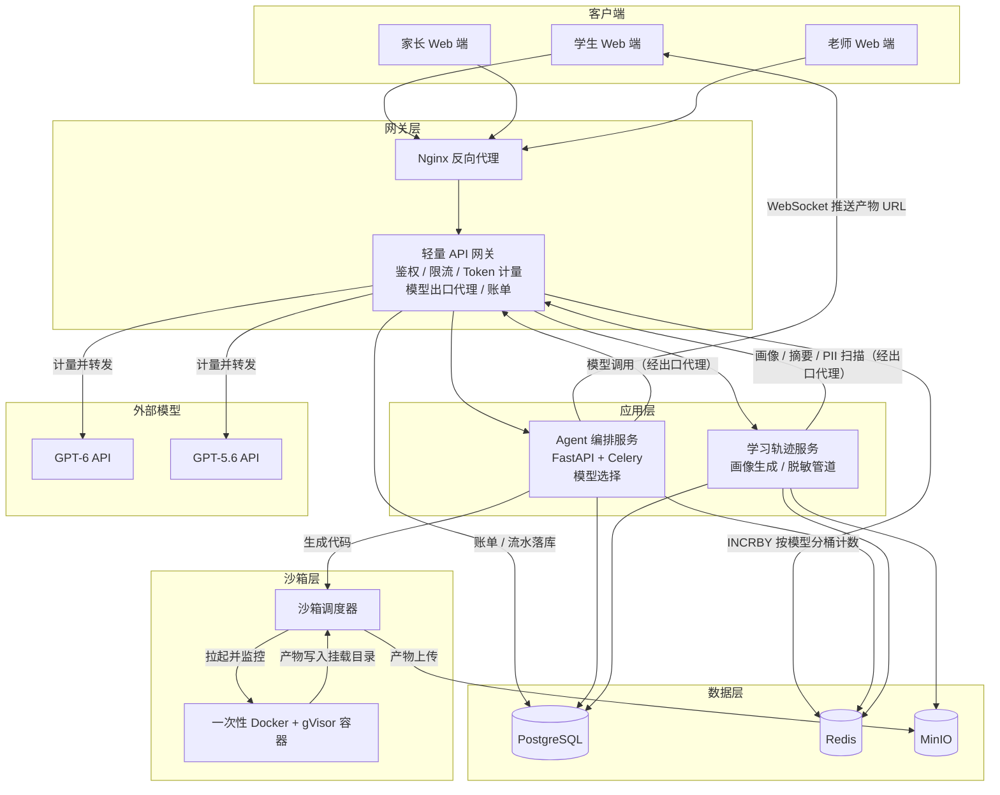

# 面向学生的通用学习 Agent 平台技术方案

>本人审题：读完题目，我对题目的理解是：某公司要和Alethic Insight合作制作AI学习平台，旨在服务约100个学生。  1.“脱敏沉淀学生的学习轨迹与思维方式”意思是指平台或许会记录学生的搜索与学习习惯，理解（沉淀）学生在哪里遇到了知识的问题并且保护学生隐私，辅助家长监督陪伴和老师教学。这就需要使用“事件日志”，记录学生每一次的提问，模型回答等等，使这些事件入库，定期让GPT-5.6做汇总分析，生成学生画像，记录偏好等等。脱敏也就是保护好学生隐私，抹掉隐私信息叫做脱敏。让家长和老师关注学习情况本身。考虑采用脱敏管道，也就是让学生的姓名，学号等信息编码加密化。设置分级可见。  2.“为同学提供AI-Native的知识获取途径”意思是指，让学生直接用AI进行学习，随时向AI提问，AI随时解答。并非形式主义而又潦草的照搬电子课本。这就需要接入GPT-6/GPT-5.6，支持学生查询资料，AI助力解答题目。  3.“基于计算机技术的可视化学习方式”，说通俗一点就是让AI生成动画，图片等帮助学生理解知识点。这就需要Agent生成动画等，让结果返回前端（网页端）。  4.“基于GPT-6/GPT-5.6系列模型”是说平台的大脑用这两个模型。GPT-6虽然强但是贵，GPT-5.6虽然便宜但是笨。这就需要我们做好模型的分工，简单问题交给5.6，复杂问题交给6。在提高该平台效率的同时节省大家的花费。  5.“模型费用家长承担”，token费用各付各的，不计入十万元的总花费，但我需要设计出计费和收款功能，以便于向家长各自收款。  6.“其余硬件架构符合成本预算”“成本预算十万级”也就是说服务器，存储等硬件和云服务总共只花十万块以内。  7.该平台就是一个AI学习助手，会调用工具的AI就是agent,我们需要让这个AI“动起来”   8.此题作为AI Infra下考题，让我重新认识了AI Infra（infrastructure基础设施）Infra负责让模型更安全，稳定，便宜的服务群众，这是工程应用，让AI系统可靠运行的基础设施。  9.考虑完这些之后，我发现学长为我留下了提示：“可视化的背后是沙箱”，这就刚好呼应了infra的安全层面，我需要借助沙箱让平台更加安全稳定。AI生成的代码不可信，需要隔离出去，万一学生让AI写一个销毁自己的代码不就炸了，我们需要借此保护主系统的数据安全。我们需要建立沙盒，每个任务独立起一个独立容器，限制内存。也就是说AI生成一个代码，丢到沙盒里跑，然后生成出的东西给学生看。这就是所谓“可视化的背后是沙盒”


> 设计约束：服务规模约 100 名学生、峰值并发约 20 人；总预算十万级（不含由家长承担的 Token 费用）；核心可视化能力依托代码沙箱实现（"可视化背后是沙箱"）。

---

## 1. 需求拆解

| 序号 | 题目要求 | 转化为技术需求 | 方案满足方式 |
|:---:|:---|:---|:---|
| 1 | 服务约 100 名学生 | 支持 100 注册用户、峰值并发 20 人 | 采用 3~4 台中等配置云服务器 + 负载均衡，不引入 K8s 等重型编排，降低运维复杂度与成本 |
| 2 | AI-Native 知识获取 | 学生可通过自然语言与 Agent 交互获取知识 | Agent 编排层对接 GPT-6 / GPT-5.6，根据任务复杂度自动路由至不同模型 |
| 3 | 可视化学习方式（基于计算机技术） | 将抽象知识以图表、动画、交互网页等形式呈现 | 两条产物路径：AI 生成 Python（Matplotlib/Plotly）代码在服务端沙箱执行产出图表；或直接生成 HTML/JS 页面（动画、交互网页）作为产物回传，由前端沙箱化 iframe 渲染 |
| 4 | 脱敏沉淀学习轨迹与思维方式 | 长期保存学习行为数据，但需去除个人敏感信息；思维方式需可提炼 | 建立事件日志系统记录学习行为；通过"姓名哈希 + 正则 + 模型"三级脱敏管道处理；GPT-5.6 定期从轨迹中提炼思维风格标签 |
| 5 | 供家长和老师参考 | 基于轨迹生成可读的画像与报告，并按角色控制可见范围 | RBAC 三角色权限：学生看本人数据，家长看孩子画像与账单，老师看班级聚合与个体脱敏画像 |
| 6 | Token 费用由家长承担 | 需要精确到学生维度的计量、账单与额度控制 | 所有模型调用经 API 网关统一出口代理，网关在转发处按模型分桶统计每个学生的 Token，按月出账单，支持额度上限提醒与熔断；平台代收代付 |
| 7 | 十万级软硬件预算 | 服务器、存储、带宽、域名、证书等年费用 ≤ 10 万元 | 采用云厂商通用型 ECS + 自建中间件（Redis、MinIO、Nginx），不做过度冗余设计，首年成本约 9 万元（含平台侧后台 Token 费用） |

**为什么先拆解再设计**：100 人规模属于典型的小微系统，若直接套用大厂中台架构，会导致大部分组件空转。逐条对齐需求后再做取舍，能确保每一笔预算都花在学生可感知的体验上。

---

## 2. 整体架构

### 2.1 分层描述

**前端层（Presentation Layer）**
>本人理解：前端即平台里学生看到的网页，需要合理技术选型和足够美观
- 技术选型：Vue 3 + TypeScript，单页应用（SPA）。
>本人理解：vue 3 +typescript 的技术组合，typescript 用来检查javascript，写错即时纠察出来，上线后不会炸。而HTML，CSS，JS单独写出来很杂乱，借助vue 3来高效组织JS代码。也就是说，数据一直会更新，使用vue会自动在所有地方响应这些更新，本质上是一个自动更新的JS系统。他编译后的产物就是他们三个，使数据更新自动完成的“管家”.而单页应用SPA保证翻页时的流畅，不刷新不白屏，只替换翻页部分而不是整本刷新。
- 职责：对话界面、沙箱产物渲染（图片直接展示，HTML/JS 页面以带 `sandbox` 属性的 `iframe` 从独立域名加载，动画与交互逻辑在 iframe 内由 Canvas/CSS 完成，JSON 用 ECharts 渲染）、家长/老师看板。
>本人理解：AI写出来的东西不可信，iframe是“网页里面嵌入一块别人的网页”要把AI生成的HTML放到sandbox中，确保里面的东西能看但不会对平台，系统造成损害。独立域名就像是双保险，让Ai生成的HTML完全对平台不构成威胁。
- **为什么用 Web 技术栈而非原生 App**：平台以桌面浏览器为主要使用场景，家长和老师需要在电脑端查看报告，一套 Web 代码覆盖三端，开发成本最低。
>本人理解：一套 Web 代码三端可用，第一期只做 Web，手机浏览器也能用。

**API 网关层（Gateway Layer）**
- 技术选型：Nginx（反向代理、HTTPS、静态资源）+ 自研轻量网关（Go / Python FastAPI）。
>本人理解：Nginx作为主流Web服务器，用于接收网络请求并分发回应，加密通信，主流而又安全。
>本人理解：采用自研轻量网关的核心原因是服务人数只有100人左右，而kong这种成熟网关有学习和维护成本。类似于酒店的前台，控制人数，核验身份，如果没有会让后端服务器暴露给用户，会增大后端的工作量，既不安全也容易出差错。
- 职责：统一鉴权（JWT）、限流（漏桶算法，防止单学生刷接口）、**模型出口代理**（编排层的所有模型 API 调用统一经网关转发，网关在转发处按学生 × 模型分桶统计 Token、执行额度检查与流式熔断）、月度账单生成。
>我的理解：token费用家长承担就由这一层落地，鉴权，计费，限流都由这一层来解决。也就是说“公共的事情统一做”，让这个平台效率更高，体系更加稳定。
- **为什么模型调用必须经网关出口代理**：计量点必须位于所有模型流量的必经之路上；若编排层直连模型服务商，网关拿不到 usage 数据，计费与额度熔断整体失效。
- **为什么自研轻量网关而非购买云 API 网关**：100 人规模 QPS 极低（< 50），云厂商托管网关的年费约占预算 15%~20%，自研网关核心逻辑仅需几百行代码，可将预算留给计算资源。

**Agent 编排层（Orchestration Layer）**
- 技术选型：Python FastAPI + Celery（异步任务队列）。
>本人理解：fastAPI可以同时满足多个人的需求。而celery相当于任务排队本，把不是现在就要得到答案的任务放到之后再去做。
- 职责：多轮对话状态管理（Memory）、工具调用（触发沙箱执行）、Prompt 工程、**模型选择策略**（判断任务走 GPT-6 还是 GPT-5.6——模型"路由"决策在编排层，网关只负责计量与转发，两者职责分离）。
>本人理解：编排层需要判断该问题应该用哪个模型，也就是“路由”。
- **为什么用 FastAPI**：异步性能足够支撑 20 并发，且 Python 生态在 LLM 集成上最为成熟。
>本人理解：编排层的核心作用：理解意图 → 选模型 → 拿回答 → 触发沙箱 → 把产物推给前端。

**沙箱执行层（Sandbox Layer）**
- 技术选型：Docker + gVisor（`runsc` 运行时）。
>本人理解：docker是一个容器技术，把一个程序打包起来，在任何电脑上都能跑起来。作为沙盒，由于AI生成的代码不可信，我们每次执行任务都要临时创建一个docker，让代码在里面跑。盒子里怎么折腾都伤不到外面。
- 职责：执行 AI 生成的 Python 可视化代码，产出图片与数据文件；由独立的沙箱调度器管理容器生命周期与产物回收。（HTML/JS 页面无需服务端执行，经安全校验后直接作为产物回传。）
- **为什么用 gVisor**：100 人场景下不需要重型的 Kata Containers 或 Firecracker，gVisor 作为用户空间内核，能在不启用嵌套虚拟化的云服务器上提供额外一层系统调用隔离，成本与安全性平衡最优。

**数据层（Data Layer）**
- 结构化数据：PostgreSQL 14（主库），存储身份映射（加密）、脱敏事件日志、画像、账单记录。
>本人理解：postgreSQL用于记录学生身份，学习记录等重要事件。
- 缓存与消息队列：Redis（对话 Session、Token 计数器、Celery Broker），开启 AOF 持久化。
>本人理解：redis记录速度更快，用于记录token，登录状态等。
- 对象存储：MinIO（沙箱产物、画像报告导出文件），以独立域名对外提供产物访问。
>本人理解：minio用于存放大件数据.
- **为什么用 PostgreSQL + MinIO 而非分布式大数据套件**：100 学生的年数据量预计在 GB 级，单机 PostgreSQL 完全够用；MinIO 兼容 S3 协议，后续迁移到云厂商对象存储成本也很低。

### 2.2 架构图



> 说明：所有指向 GPT-6 / GPT-5.6 的边都从网关 E 发出，且 E → K（计量计数）与 E → J（账单落库）两条边与第 5.2 节的计费链路一一对应；产物路径 I → H → L →（URL 经 F 推送）→ A 与第 3.5 节的回传流程一致。

>本人理解：整张图两个关键：所有模型调用都过网关（不然没法计费），沙箱没有任何连出去的线。

---

## 3. 核心设计一·沙箱

### 3.1 为什么 AI 生成的代码必须隔离执行

学习 Agent 在回答数学、物理、编程问题时，会主动生成两类可视化产物：**需要在服务端执行的 Python 代码**（Matplotlib、Plotly、NumPy），以及**直接交付前端渲染的 HTML/JS 页面**。其中 Python 代码由大模型生成、不可信，存在以下风险：
1. **恶意代码注入**：模型可能被诱导生成 `os.system('rm -rf /')` 或探测内网的代码；
2. **资源耗尽型攻击**：无限循环、`fork` 炸弹、内存泄漏；
3. **网络外联**：代码可能试图访问外网下载恶意脚本，或把对话内容发送到外部服务器；
4. **数据污染**：若沙箱与主服务共享文件系统，AI 代码可能篡改平台数据；
5. **产物通道反噬**：即使执行环境隔离了，产物回传环节仍可能被利用（如在输出目录放置指向宿主机敏感文件的符号链接，诱使调度器把宿主机文件"读出来"）。

**为什么不直接在前端渲染 AI 代码**：前端执行不可信 JS 会带来 XSS 风险，且 Python 科学计算生态无法在前端运行。正确做法是"服务端沙箱执行 + 产物安全回传"——注意这只是把风险从"执行"转移到了"展示"与"搬运"，因此产物回传前端时仍需配套防护（见 3.5 的符号链接校验、iframe 沙箱与 CSP）。
>本人理解：xss就是把恶意脚本注入网页，对平台造成威胁，我们一贯采取的防御思路是AI生成的代码在沙箱执行。不直接接触主站页面。

### 3.2 隔离方式：一次性 Docker 容器 + gVisor

| 维度 | 实现方案 | 为什么这么做 |
|:---|:---|:---|
| 容器运行时 | Docker + gVisor (`runsc`) | gVisor 拦截系统调用，在用户空间实现内核，防止容器逃逸；相比 Kata Containers 不需要嵌套虚拟化支持，适配更多云厂商实例 |
| 容器生命周期 | 一次请求 = 一个容器 | 执行完毕后立即 `docker rm -f` 并删除任务目录，彻底消除残留状态被后续请求利用的可能 |
| 镜像选择 | 基于 `python:3.11-slim` 定制，仅预装 matplotlib、plotly、numpy | 镜像体积控制在 300MB 以内，缩短冷启动；不安装编译工具链（gcc/make）与重型依赖（如 Manim 需要 ffmpeg/LaTeX，与 slim 镜像矛盾且 30 秒超时内也跑不完），减少攻击面；动画类需求改由 HTML/JS 产物在前端 iframe 内实现 |
| 编排调用 | 沙箱调度器（独立节点）通过 Docker API 创建容器 | 沙箱节点与应用节点物理隔离，即使沙箱被攻破，攻击者也无法直接触达主数据库 |

>本人理解：docker是个一次性容器盒，代码跑完就扔掉；但盒子和宿主机共用一根"煤气管道"（内核），gVisor就是在管道前加的安检员，危险指令到不了真内核。

### 3.3 资源与权限限制

| 资源 | 限制值 | 说明 |
|:---|:---|:---|
| CPU | 1 vCPU（`--cpus=1`） | 防止计算密集型任务挤占宿主机；沙箱节点 4 vCPU 可同时并行 4 个沙箱，其余排队（容量论证见第 6 节） |
| 内存 | 512 MB（`--memory=512m`） | 满足教学级可视化需求，超出即 OOM kill |
| 超时 | 30 秒 | 教学图表生成通常在 5 秒内完成；调度器看门狗超时后强制 `docker kill` |
| 磁盘 | 每任务独立宿主机目录，配额 100 MB | **为什么用宿主机 bind mount 而非 tmpfs**：tmpfs 是容器内内存文件系统，容器退出后宿主机读不到产物；bind mount 让调度器在容器退出后能直接读取产物，配合配额与定时清理防止磁盘灌满 |
| 进程数 | `--pids-limit=50` | 防止 fork 炸弹 |
| 容器内身份 | `--user=65534`（nobody）+ `--read-only` + `--cap-drop=ALL` | 容器内默认 root 是常见疏漏：以 nobody 运行、根文件系统只读（仅 /output 可写）、丢弃全部 Linux capabilities，即使代码拿到执行权也无法提权或篡改容器系统 |
| 产物大小 | 单产物 ≤ 5 MB | 超限拒绝回传，避免带宽与存储拥塞 |

>本人理解：这些限制设计都是为了防熊孩子，让电脑稳定为这么多人提供服务，比如熊孩子让生成圆周率后一亿位，肯定是一种浪费资源，所以只给cpu1核。

### 3.4 网络白名单控制

- **默认策略：DROP 全部出向流量——包括公网和内网**，沙箱容器完全不接入任何可路由网络（`--network=none`）。
- **为什么连内网 MinIO / Redis 也不放通**：产物回传由宿主侧调度器完成（容器只需写挂载目录），沙箱没有任何合法的网络访问需求；放通内网反而让被攻破的沙箱成为探测 Redis、MinIO、数据库的跳板。白名单的极致形态就是"零放行"。
- **实时数据怎么办**：若学生要求展示实时数据（如天气、股价），由 Agent 编排层在沙箱**外**完成数据获取，清洗后作为输入文件注入沙箱，沙箱本身始终不出网。
>本人理解：沙箱没有要网络的理由，产物是从外面拿，数据是由编排层搞定的，安全起见不给沙箱内网。

### 3.5 产物如何安全回传前端

```
Agent 编排层生成代码
        ↓
调用沙箱调度器 → 创建任务目录 → 启动一次性容器
（gVisor，nobody 身份，根文件系统只读，任务目录 bind mount 至 /output）
        ↓
容器内执行代码，产物写入 /output
        ↓
容器退出（或被看门狗超时 kill），调度器从宿主机侧读取任务目录
        ↓
调度器安全校验（关键一步）：
  - 拒绝符号链接：以 O_NOFOLLOW 打开，校验 isfile 且非 link，
    防止容器内代码放置指向 /etc/passwd 等宿主机文件的 symlink 被"读出来"
  - 校验文件类型（魔数嗅探，不信任扩展名）与大小
        ↓
上传至 MinIO，生成 15 分钟过期的预签名 URL
        ↓
Agent 编排层将 URL 通过 WebSocket 推送至前端
        ↓
前端渲染：图片直接 ；HTML 以 <iframe sandbox="allow-scripts"> 加载，
        且产物统一从 MinIO 的独立域名提供（与主站 Cookie 隔离），
        响应头附加 CSP: default-src 'self'，禁止产物脚本携带主站会话发起请求
```

（HTML/JS 页面类产物不经过容器执行，但**同样经过上述符号链接校验、类型嗅探、独立域名 + CSP 的全套回传防护**。）

- **为什么用 WebSocket 而非 HTTP 轮询**：沙箱执行耗时 1~10 秒不等，轮询会产生大量无意义请求；产物就绪后即时推送，降低网关压力和延迟。
- **为什么 HTML 产物还要 iframe sandbox + 独立域名 + CSP**：AI 生成的 HTML 仍是不可信内容，若不隔离，其中的脚本可以在主站源下读取学生 Cookie——这会把 3.1 论证过的 XSS 风险重新引回来。`sandbox` 属性禁掉同源访问与表单提交，独立域名做源隔离，CSP 作为第二道防线。

>本人理解：容器全程碰不到网络也碰不到前端网页。

---

## 4. 核心设计二·学习轨迹沉淀与脱敏

### 4.0 威胁模型声明（先说明"脱敏防的是谁"）

脱敏管道的保护目标需要明确，否则整个设计会被质疑"原文都发给模型服务商了，脱敏有什么意义"：

- **学生对话原文因产品形态必然经过模型服务商处理**（不发给 GPT-6/5.6 就无法作答）——这一层靠与模型服务商的数据处理协议（DPA）约束，不属于脱敏管道的防护范围；
- **脱敏管道防的是两件事**：① 平台自己的**沉淀数据库泄露**（库被拖、备份丢失时，攻击者拿不到可关联到真人的数据）；② **内部越权访问**（运营、老师、其他家长不能看到不该看的明文身份与隐私细节）。
>本人理解：原文发给模型服务商是产品刚需（不发就没法答题）脱敏管道防的是另外两件事：① 我自己的数据库被拖库——黑客拿到的只是一堆哈希，对不上真人；② 内部人越权——运营、老师、别的家长看不到不该看的明文。

在此威胁模型下，摘要与 PII 扫描调用 GPT-5.6 不构成新增暴露面（原文本就要发给同一家服务商）；若未来合规要求收紧（如教育主管部门禁止原文出域），可将第三层模型扫描替换为本地 NER 小模型（如微调的中文实体识别模型），用可接受的漏检率换取原文不出域——架构上第三层是可插拔的。

### 4.1 事件日志记录哪些字段

每张学习事件表（`learning_events`）记录一次学生与 Agent 的交互原子行为：

| 字段名 | 类型 | 说明 |
|:---|:---|:---|
| `event_id` | UUID | 全局唯一标识 |
| `timestamp` | TIMESTAMPTZ | 事件发生时间 |
| `student_id_hash` | CHAR(64) | 学生标识的 HMAC-SHA256 哈希（密钥由平台保管，支持密钥轮换时批量重哈希），**行为库不落明文身份** |
| `session_id` | UUID | 对话会话标识 |
| `event_type` | VARCHAR(32) | `chat` / `code_gen` / `sandbox_exec` / `tool_call` / `error` |
| `model_used` | VARCHAR(16) | `gpt-6` / `gpt-5.6` |
| `tokens_input` | INT | 该请求消耗的 Input Token |
| `tokens_output` | INT | 该请求消耗的 Output Token |
| `subject_tag` | VARCHAR(32) | 学科标签（由 GPT-5.6 分类生成） |
| `content_summary` | TEXT | 经 GPT-5.6 实时摘要、并经过脱敏管道后的对话主题（非全文） |
| `metadata` | JSONB | 扩展字段：代码语言、沙箱执行状态、追问轮次（用于推断思维深度）、错误码等 |

**关于原始对话的留存策略（明确边界）**：`learning_events` **不存对话原文**。原文单独存于一张短期表 `raw_conversations`（或 Redis），TTL 7 天，仅用于故障排查与投诉追溯，到期物理删除；该表与行为日志分离，且任何画像、报表流程都不读取它。长期沉淀只保留"学了什么、怎么学的、思维路径如何"的脱敏摘要与结构化指标。

### 4.2 如何用 GPT-5.6 定期生成学生画像

**流程**：
1. **触发时机**：每周日凌晨 2:00（业务低峰期），Celery 定时任务扫描上周的 `learning_events`；
2. **输入构造**：按 `student_id_hash` 聚合，抽取该生一周的学科分布、错误类型、代码生成频率、链式追问次数（思维深度指标）、沙箱任务成功率等结构化指标，并附上各主题的 `content_summary` 汇编（已脱敏文本，提供"问了什么"的语义信号，弥补纯计数指标的浅薄）；
3. **模型调用**：将聚合输入经网关出口代理送入 GPT-5.6，Prompt 要求输出固定格式的画像 JSON，包括：
   - `knowledge_gaps`：知识薄弱点列表
   - `thinking_style`：思维风格标签（如"演绎型"、"试错型"、"跳跃型"）——对应题目要求的"思维方式"沉淀
   - `engagement_score`：参与度评分（1-10）
   - `recommendation`：下周学习建议
4. **结果存储**：画像 JSON 存入 PostgreSQL，静态报告 HTML 存入 MinIO。

**为什么用 GPT-5.6 而非 GPT-6 做画像**：画像生成是离线批处理，输入已高度结构化，对推理深度要求低于实时教学；GPT-5.6 成本更低、吞吐更高，适合周期性批量任务。

### 4.3 脱敏管道：姓名哈希 + 正则与模型双保险

```
原始数据输入
    ↓
第一层：身份哈希化（对应题目"姓名哈希"）
    - student_id / 姓名 → HMAC-SHA256（平台密钥），行为库只存哈希
    - 明文姓名、学号、家长手机号等身份信息独立存于身份库（字段级加密），
      仅用于家长-学生绑定、授权角色查询时的显示名回填，绝不进入日志与画像
    ↓
第二层：正则规则扫描（本地执行，先于任何模型调用）
    - 手机号：1[3-9]\d{9}
    - 身份证号：\d{17}[\dXx]（兼容 15 位旧证：\d{15}）
    - 邮箱：标准正则
    - 地址关键词：省/市/区 + 路/街/号
    - 命中后替换为 [PII-REDACTED]
    ↓
第三层：GPT-5.6 模型识别（与正则构成双保险）
    - 对文本再次扫描，识别人名、学校名、亲属称谓等上下文敏感 PII
    - 判定策略：宁滥勿缺——模型标记为"疑似 PII"即 REDACT，
      不依赖模型自报置信度数值（LLM 的置信度未经校准，写阈值是伪精确）；
      对画像质量有影响的误杀样例进入人工抽检队列复核
    ↓
入库 & 进入画像生成流程
```

**为什么要"正则 + 模型"双保险**：正则对结构化 PII（手机号、身份证）准确率接近 100% 且零推理成本，但对"我住在清华大学旁边"这类隐含地址无能为力；模型能覆盖上下文敏感信息，但存在漏检概率。两者串联互补，任何一层失效仍有另一层兜底。**正则层刻意放在模型层之前且在本地执行**：先把确定性 PII 拦在本地，减少送出的敏感信息量。
>本人理解：正则抓格式固定的（手机号、身份证），模型抓要看上下文才懂的（人名、地址暗示），一个管准，一个管全。

**为什么身份信息要独立成库而非直接丢弃**：家长和老师的看板需要按学生姓名查看画像——若姓名彻底丢弃，界面上只剩哈希值无法使用。身份库与行为库分离、字段级加密，授权角色查询时由后端按权限回填显示名，行为数据本身始终匿名。

### 4.4 RBAC：学生 / 家长 / 老师分别能看到什么

| 角色 | 可见内容 | 不可见内容 | 为什么这样设计 |
|:---|:---|:---|:---|
| **学生** | 自己的当前对话、历史学习主题、个人画像报告 | 他人任何数据；账单金额明细（避免学生围绕额度焦虑） | 保护未成年人数据主权，同时提供自我认知反馈 |
| **家长** | 自己孩子的脱敏学习画像、周/月学习趋势、学科薄弱点；**月度 Token 账单、额度设置与提额申请** | 具体对话原文、涉及学校/同学姓名的上下文 | 家长是 Token 费用的承担方，账单与额度必须对其可见（这是计费闭环的必要条件）；但无需窥探孩子对话细节，脱敏后避免家庭与社交隐私外泄 |
| **老师** | 全班聚合画像（共性薄弱点、教学建议，应用 **k-匿名阈值**：某标签涉及学生 < 5 人则不予展示）、单个学生的脱敏画像标签（经显示名回填） | 任何学生的原始对话、可反推个人身份的细粒度时序数据、账单 | 老师关注教学策略优化而非个体隐私；小规模班级（30~100 人）聚合数据量小，差分隐私噪声会直接淹没信号，k-匿名阈值是同等防护强度下更可辩护、也更诚实的选择 |

>本人理解：付钱的人必须看得到账，所以家长能看账单，但聊天原文谁都不给看。

---

## 5. 核心设计三·模型路由与计费

### 5.1 什么任务走 GPT-6、什么走 GPT-5.6，以及理由

| 任务类型 | 路由模型 | 理由 |
|:---|:---|:---|
| 复杂数学/物理推导、创意写作、编程 Debug、可视化代码生成（进入沙箱） | **GPT-6** | 需要最强推理能力与代码正确性，学生直接感知答案质量，不可妥协 |
| 日常知识问答、学科分类、PII 识别、日志摘要、学生画像批量生成 | **GPT-5.6** | 任务模式固定、容错空间较大；GPT-5.6 速度更快、单价更低，适合高频与批量任务——若画像批处理全走 GPT-6，成本将成倍上升 |
| 简单寒暄 / 问候 | **本地规则 / 模板回复** | 无需调用模型，零 Token 消耗 |

**路由决策在哪做**：在 **Agent 编排层**。编排层先用本地规则与轻量分类器判断意图，无法判定时才用 GPT-5.6 做意图分类（避免"为了判断该不该调模型而先调一次大模型"的浪费）。判定为"画一个正弦函数图像并解释相位" → 走 GPT-6 生成代码与解释；判定为"什么是光合作用" → 走 GPT-5.6 直接回答。**网关不参与路由决策，只做计量、额度检查与转发**——决策与计量分离，职责单一，任一侧失效不影响另一侧。

### 5.2 如何在网关按学生维度统计 Token、出月度账单、做额度提醒

**计量点**：编排层的所有模型调用统一经**网关出口代理**转发至模型服务商。网关在转发响应（流式则逐 chunk 累加）时解析 `usage` 字段，以 `INCRBY` 写入 Redis Hash：

- Key：`token:usage:{student_id_hash}:{YYYYMM}`
- 字段（**按模型分桶**，这是金额折算的前提）：`gpt6_in` / `gpt6_out` / `gpt56_in` / `gpt56_out`
  - **为什么必须分桶**：GPT-6 与 GPT-5.6 单价不同，若只记一个 `total`，"等价于 XX 元"的额度检查和账单金额都无从算起——混合 token 总数乘哪个单价都是错的
- TTL：**45 天**。额度检查只看当月，账单次月 1 日落 PostgreSQL 后长期保存，Redis 无需长期保留
- 可靠性：Redis 开启 AOF 持久化，防止应用服务器重启丢账；每日凌晨将 Redis 计数与 PostgreSQL 流水做对账，偏差告警

>本人理解：单价不同所以分开记。

**月度账单**：每月 1 日凌晨，定时任务汇总上月各学生 Key，**按模型分别乘以对应官方单价后加总**，写入 `monthly_bills` 表：`student_id_hash`、`billing_period`、分模型 token 明细、`estimated_cost_cny`、`status`（`pending`/`paid`/`over_limit`）。**费用由平台代收代付（家长端充值制）**——家长无法也不应直接对接模型服务商付款。

**人均月账单估算（回答"家长一个月要交多少钱"）**：

按 §6.1 的假设：60 名日活学生 × 10 轮/日 × 1,400 token/轮 ≈ 全校 2,520 万 token/月，人均约 **42 万 token/月**。按路由分布与占位单价估算（单价为假设值，落地时按 GPT-6/5.6 实际官方价替换）：

| 构成 | 占比 | 人均月 Token | 占位单价 | 人均月费用 |
|:---|:---:|:---:|:---:|:---:|
| GPT-6（复杂推理/代码生成） | 20% 轮次 | 8.4 万 | ¥30 / 百万 token | ≈ ¥2.5 |
| GPT-5.6（日常问答等） | 75% 轮次 | 31.5 万 | ¥4 / 百万 token | ≈ ¥1.3 |
| 本地模板（寒暄） | 5% 轮次 | — | 0 | ¥0 |
| **合计** | | **约 40 万** | | **≈ ¥4，上限情形 < ¥15** |

**额度上限与提醒**：
- 每个学生设定月度 Token 上限，**默认等价于 20 元 RMB**（约为估算人均消费的 5 倍，留有充足余量；家长可在家长端调整）。
- 网关在每次转发前检查当月加权累计值：
  - 达到 80%：WebSocket 推送学生端预警并通知家长端；学生不在线时预警落库，下次登录补推；
  - 达到 100%：拒绝后续模型请求，提示"请联系家长在家长端提额或等待下月重置"。
- **预检防不住的两类超支及对策**（这是计费系统的经典漏洞，主动交代）：
  1. **单请求击穿**：转发前无法预知 output token 量，一次长回答即可越过上限——对策是**流式响应中途累计计量，超限即中断连接**，该请求按实际已产生量计费；

  >本人理解：转发前不知道回答会有多长，所以边输出边计费、超限就掐断。

  2. **并发过检（TOCTOU）**：同一学生的多个并发请求可能同时通过预检——对策是检查与计数用 Redis Lua 脚本做成原子操作，且允许单请求小额超支（≤ 额度的 2%）**挂账、下月抵扣**，不为边界情况牺牲可用性。

**两类 Token 分开记账**：
- **学生发起的对话与可视化**：计入学生月度账单，家长承担；
- **平台发起的后台批处理**（画像生成、PII 扫描、日志摘要、意图分类兜底）：单独记入平台运营账户，由平台承担，**不出现在家长账单上**——否则家长在为自己没有发起的调用付费，既不公平也会产生账单纠纷。该部分成本已量化并纳入第 6.2 节预算表。

---

## 6. 成本估算

### 6.1 规模假设

- 注册用户：100 名学生；峰值并发：20 人在线；日均活跃：60 人
- 人均日对话 10 轮，其中约 2 轮触发可视化（沙箱执行）
- 单轮平均 Token：Input 800 + Output 600 = 1,400 Tokens

### 6.2 服务器配置与费用表

| 资源 | 规格 | 数量 | 月费用 | 年费用 | 说明 |
|:---|:---|:---:|:---:|:---:|:---|
| 应用服务器 | 通用型 8 vCPU / 16 GB / 100 GB SSD | 2 台 | ¥4,400 | ¥52,800 | 运行 Nginx、网关、Agent 编排、Celery 等**无状态服务**，双机互备可切流；Redis、MinIO 为有状态单点（见下两行说明） |
| 沙箱执行节点 | 通用型 4 vCPU / 8 GB / 50 GB SSD | 1 台 | ¥1,100 | ¥13,200 | 专跑 Docker + gVisor，与应用层物理隔离 |
| 数据库 | 云托管 PostgreSQL：4 vCPU / 8 GB / 200 GB SSD | 1 套 | ¥800 | ¥9,600 | 100 学生年数据量 < 50 GB，单机托管实例足够；账单流水落库于此，是 Redis 计数丢失时的兜底账本 |
| 存储扩容 | MinIO 数据盘 500 GB 云盘 | — | ¥200 | ¥2,400 | MinIO 单点部署于应用服务器；产物丢失可由对话重新生成，画像报告有 PG 内 JSON 可重建 |
| 公网带宽 | 5 Mbps 保底带宽 + 按流量计费 | — | ¥500 | ¥6,000 | 流量以文本与图片为主，月流量费百元级；**不采购 50 Mbps 固定带宽**（市价约 ¥2,000+/月，对此场景是浪费） |
| 负载均衡 | CLB 基础版（四层 TCP 转发） | 1 个 | ¥200 | ¥2,400 | 双应用服务器切流；不购 WAF，限流在自研网关实现 |
| 域名 + 证书 + 监控告警 | 域名年费 + Let's Encrypt 免费证书 + 短信告警 | — | ¥150 | ¥1,800 | 主要支出为域名与告警通道 |
| 平台后台 Token 费用 | 画像生成、PII 扫描、日志摘要（GPT-5.6） | — | ¥170 | ¥2,040 | 估算见下方说明；**明确计入预算**，不以"运营经费"含糊带过 |
| **合计** | | | **¥7,520** | **¥90,240** | 按云厂商目录价保守估算，包年包月实际成交价通常更低 |

**平台后台 Token 估算**：PII 扫描与日志摘要需处理全部学生消息（约 2,520 万 token/月输入），叠加每周画像批处理，合计约 5,000 万 token/月；按 GPT-5.6 占位单价 ¥4/百万 token 计 ≈ ¥200/月，取 ¥170（部分扫描文本为去重后内容）。即使单价上浮 5 倍，年费用仍 < ¥1 万，不撼动预算结论。

**关于"双机互备"的诚实边界**：两台应用服务器对 Nginx/网关/编排等无状态服务确实可互备切流；但 Redis（Token 计数）与 MinIO（产物）是有状态单点——Redis 故障时以 PostgreSQL 计费流水为权威账本重建计数，MinIO 故障时产物可重新生成。不为 100 人场景的有状态组件做双活，是成本与可靠性的理性取舍（见 7.5）。

### 6.3 沙箱节点容量论证（为什么 4 vCPU 够）

20 并发**在线用户**不等于 20 个并发**沙箱**。按 6.1 的假设，对话中仅约 20% 的轮次触发可视化，且单轮对话间隔以十秒计——峰值时刻同时处于沙箱执行中的任务约 4~6 个。4 vCPU 节点可并行运行 4 个沙箱（各限 1 vCPU），其余进入队列，极端排队等待约 10~20 秒，对学生端体验可接受；队列长度设上限（如 20），超出直接返回"系统繁忙请稍候"，防止积压雪崩。若日后并发翻倍，加一台同规格节点即可线性扩容（沙箱无状态）。

### 6.4 预算充足性论证

- **首年总成本约 9.0 万元**（¥90,240，已含平台后台 Token 费用），低于十万预算，剩余 **约 9,800 元**作为风险缓冲：
  - 突发流量（如公开课演示周）临时升配应用服务器或**按量临时增加沙箱节点**（约 ¥37/天/台，演示周级别开销仅数百元）；
  - 数据盘扩容、异地快照备份。
- **明确的取舍边界**：若需要**长期**增加一台沙箱节点（约 ¥1.3 万/年），将超出缓冲，需单独审批追加预算或下调其他配置——不隐瞒这一点，正是预算论证诚实性的一部分。
- **Token 费用的边界**：学生对话 Token 由家长充值、平台代收代付，不占用十万预算；平台后台 Token 已量化并入表（¥2,040/年）。
- **为什么不做双活多区部署**：100 人场景 RTO 可放宽至 30 分钟，单区双机 + 每日快照的可靠性已远高于业务所需；跨区部署会使成本上升 60% 以上，收益极低。

---

## 7. 风险与取舍

### 7.1 为什么不用 Kubernetes

**取舍结论**：采用 Docker Compose + 自定义部署脚本，不引入 K8s。

- **成本角度**：K8s 至少需要 3 台 Master 节点（或托管集群管理费），对于总共 3~4 台机器的集群，K8s 控制面会吃掉 25%~30% 的计算资源与预算。
- **运维角度**：K8s 学习曲线陡峭，小团队排查 Pod、Service、Ingress、CRD 的故障链条耗时；Docker Compose 文件直观，新人 1 天即可上手。
- **扩展性兜底**：平台代码本身已容器化，未来规模扩大到 500 人以上时迁移 K8s 只需补写 YAML，不存在架构推倒重来。

### 7.2 脱敏漏检的兜底

- **问题**：即使正则 + GPT-5.6 双保险，仍可能存在新型 PII（如小众社交平台账号、方言谐音姓名）漏检。
- **兜底策略**：
  1. **数据最小化**：原始对话 7 天物理删除，长期只存脱敏摘要与结构化指标，压缩泄露基数；
  2. **k-匿名阈值**：老师端班级聚合画像中，涉及学生 < 5 人的标签不展示——小班规模下差分隐私噪声会淹没信号，k-匿名是同等防护意图下更务实的实现；
  3. **人工抽检**：每周随机抽取 0.5% 日志样本人工复核 PII 漏检，漏检样例反哺正则规则与模型 Prompt 持续优化；
  4. **威胁模型兜底**：若监管升级为"原文不得出域"，第三层模型扫描整体替换为本地 NER 模型（见 4.0），管道其余部分不变。

### 7.3 沙箱资源防刷

- **问题**：学生可能故意让 AI 生成计算量极大的代码（如挖矿模拟、无限递归分形），或高频触发沙箱消耗节点资源，甚至尝试利用产物通道攻击（符号链接、伪装文件类型）。
- **防护策略**：
  1. **单用户并发限制**：每学生同时最多 1 个沙箱任务，新请求排队；
  2. **速率限制**：单学生每分钟最多触发 5 次沙箱执行，全局队列长度封顶；
  3. **资源与权限硬封顶**：CPU 1 核 + 内存 512 MB + 30 秒超时 + `--network=none` 完全断网 + nobody 身份 + 只读根文件系统，恶意代码影响范围被锁死在单个一次性容器内；
  4. **产物通道校验**：调度器读取产物时拒绝符号链接、按魔数嗅探类型（见 3.5），堵住"执行环境隔离了但搬运环节被利用"的旁路；
  5. **行为审计**：某学生沙箱任务失败率（OOM/超时）连续 10 次超过 80%，自动冻结其代码执行权限 1 小时，并通知老师关注——把"防刷"同时变成"教学信号"。

### 7.4 模型服务商依赖

- **问题**：GPT-6 / GPT-5.6 的 API 存在变更、限速、价格波动等不可控因素；价格变动直接冲击家长账单与本方案的单价假设。
- **应对**：模型调用在编排层封装统一抽象接口（Adapter 模式），预留降级路由；主模型超时或报错时自动 fallback 到备用模型，并在回复中标注"当前处于降级模式"，保障教学连续性；网关计量按模型分桶且单价配置化，调价只需更新单价表，不改计费链路；家长端账单展示所用单价，价格透明可追溯。

### 7.5 数据持久化与灾备

- **问题**：单区部署存在可用区级别故障风险；Redis 单点可能丢失额度计数。
- **取舍与应对**：不建异地双活，执行低成本策略——
  - PostgreSQL 每日自动快照保留 7 天；
  - Redis 开启 AOF，每日与 PG 计费流水对账；**PG 流水是计费权威账本**，Redis 计数只是它的加速器，丢失可重建；
  - 关键数据（画像、账单）每月导出至异地冷存储（年费 < 500 元）；
  - 最坏情况接受 24 小时数据回退——对学习平台而言业务影响可控，为这点风险建双活不划算。

---

>本人理解：这道题表面上是让我设计一个学习平台，实际上考的是怎么让AI可靠地为真实用户服务，真正和别的方案拉开差距的是沙箱、脱敏、计费这些"看不见的地基"，而地基正是AI Infra的意义。

*方案完。*
