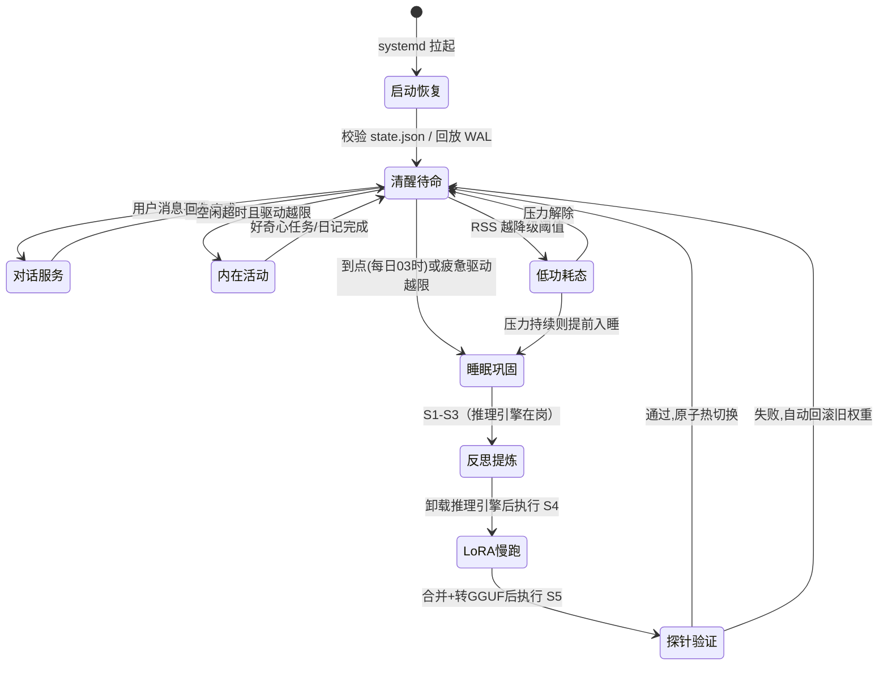

# 常驻型 Artificial Life 设计方案

**约束条件：纯 CPU、8 GiB 内存、文本模态、常驻运行、可运行、可学习**

---

## 1. 题意理解
>本人理解：1，既然要满足在电脑cpu上常驻，也就是说artificial life必须用处理器跑。cpu中央处理器上跑大模型速度极慢，我们只能选择小模型，这样才能保证该模型可用。至于常驻，比如我们平常用的“小爱同学”，你需要按下按钮他出来，回答完他消失。每次都从头开始，常驻与之不同，就像是住在电脑里的一个活物，技术上是一个后台进程。开机他就在，自始至终占据着他那部分内存。后台默默运行，不用的时候也存在，在后台整理记忆，做自己的事。这也就是方案里后续会设计“睡眠巩固”的原因。常驻也是“生命感”的由来，只有他一直在那里，有独处的时间，才有整理记忆和自我演化的可能。2，只有文本模态，输入输出都是文字，不用考虑vlm等等的事。3，至于artificial life 下文给了详细的解释，他不是聊天机器人，而是一个活的东西，有自己的记忆，目标，会主动干活的数字生命。4，不超过8g内存，这就需要我们有一个预算，我们把模型，记忆，系统全都装进去不能超过8g。5，题目提到可以运行并学习，那么这个模型光能聊天也不够，还需要自己积累经验，自己学习，越活越聪明。这和之前提到的整理记忆等不谋而合。现在就可以开始肆意处理题目了。


>本人理解：本题真正的难点有二：1，8G怎么装下？这其实是一个算账题了，我先列一下预算：｛1｝操作系统和基础运行（2G改不了）｛2｝模型（模型训练完后储存的一切数据，在模型启动后加载进内存，之后会一直待在那，这一块需要压小）（2G之内） ｛3｝模型运行时的状态（也就是当前对话的短期记忆，每聊一句都在扩大，这一块需要管住）(1G之内)｛4｝记忆系统（1G），留下2G左右余量。所以我们需要借助量化，用量化（给模型参数降低精度来节省内存）压缩大小。一个正常精度为12G的模型，量化后也许只需要2G。所以我们需要小模型+量化。  2，为小模型定义新的学习；8G+CPU不可能像企业那样训练大模型，我们先拆开模型学习的路径，首先模型需要记住，将对话和事件存入本地数据库。其次模型需要总结提炼知识点，形成知识，最后模型要不断更新自己的知识库，让模型先记录，再用时检索。至于transformer，他会随着对话变长然后越来越多。比如RWKV这种新架构不管对话多长，运行状态占用固定不变。对于这种常驻生命来说，这是天然优势，既然他需连续运行，内存占用必须是可预测的。

### 1.1 Artificial Life 的学术定义

Artificial Life（人工生命）由 Christopher Langton 于 1987 年确立为独立学科，其研究对象是"如其可能存在之生命"（life-as-it-could-be），而非对地球生命的模拟。题目中的 Artificial Life 不是一个修辞，而是有一组可对照的学术判据。本方案以以下四个判据作为设计验收的概念锚点：

| 判据 | 学术来源 | 工程含义（本方案落点） |
|---|---|---|
| 自创生（Autopoiesis） | Maturana & Varela, *Autopoiesis and Cognition* (1980)：系统持续生产并维护构成自身的组件，具有操作闭合性 | 系统自己维护自身的记忆库、权重版本、自我文档与运行节奏，人类只是环境而非操作者（§5、§6） |
| 内稳态（Homeostasis） | Cannon (1926)；Ashby 的 Homeostat（*Design for a Brain*, 1952）：内部变量被维持在设定点附近 | 驱动变量（社交、好奇、疲惫）与资源变量（RSS、错误率）均有设定点与纠偏行为（§6、§8） |
| 内在动机（Intrinsic Motivation） | Schmidhuber (1991) 的好奇心/压缩进展理论；Oudeyer & Kaplan (2007)：无外部奖励时仍内生地产生目标 | 空闲时自发执行好奇心任务、写日记、更新自我认知文档，而非沉默等待输入（§6） |
| 自我模型（Self-Model） | Metzinger, *Being No One* (2003)：系统持有一个关于自身的、可被自身查询和更新的表征 | 持久化的 `self.md` 自我认知文档 + 语义记忆中关于自身的事实，经反思持续修订（§5、§6） |

### 1.2 与聊天机器人的本质区别

| 维度 | 聊天机器人 | Artificial Life（本方案） |
|---|---|---|
| 状态连续性 | 会话结束即状态终结，记忆寄生于对话历史 | 状态跨会话、跨重启、跨断电连续（§8 持久化） |
| 活动来源 | 完全由用户输入驱动（stimulus → response） | 内生活动：无输入时仍有感知、评估、行动（§6 事件循环） |
| 学习 | 权重冻结，"学习"至多发生在上下文内 | 三层学习：情节记忆、语义记忆、低速权重更新（§5） |
| 自我维持 | 无；崩溃与资源管理是运维的事 | 自己监测自身资源并优雅降级，崩溃自愈（§8） |
| 会话边界 | 以会话为生命单位 | 以进程生命周期为生命单位，会话只是环境事件 |

一句话概括：**聊天机器人是一个被调用的函数，Artificial Life 是一个持续存活的进程**。大模型在其中只是一个器官（相当于语言中枢），有机体本身是"主循环 + 记忆系统 + 驱动变量 + 持久化状态"的整体。

>本人理解：对于“生命感”，我们需要有一些出彩的地方。我会把这个模型想象成一个聪明，不用休息的宠物。而生命需要有器官，感知器官，记忆器官，内驱力，行动力，昼夜节律。这些都是建立在模型身上可做到的，视觉，触觉等这里受限，不作考虑。而我想到的昼夜节律其实来自于设计aid，对齐的那道题。那道题里模型夜间进行思考。我们这个模型也可以夜间思考。白天随我们一起清醒，响应我们。夜间睡眠，整理一天的记忆，把重要的知识点压缩进知识库。利用我睡觉时候的CPU。在我们睡觉时，他做梦，整理记忆。

### 1.3 "不局限于 Transformer"的提示作用

这句提示有两层含义，本方案都予以正面回应：

1. **架构选型层**：2026 年，RWKV-7、Mamba 等恒定状态（constant-state）架构已经成熟。它们的状态大小为 O(1)、与上下文长度无关，且状态可整体序列化——对"常驻"场景天然友好。本方案在 §4.3 对 Transformer 与非 Transformer 架构做带数字的对比，并给出取舍。
2. **系统设计层（更深层）**：它提醒设计者——**生命的"自我"不应寄存于任何一次前向计算的上下文窗口里**。无论底层是 Transformer 还是 RWKV，KV cache 或 RNN state 都只是短期工作记忆，都会随上下文截断而丢失。因此本方案把"自我"放在外部记忆系统与版本化权重中，使模型架构成为可替换的器官（§4.4 抽象层），这正是对提示的最根本回应。

---

## 2. 硬件假设与验收标准

### 2.1 硬件与系统假设

| 项 | 假设值 | 说明 |
|---|---|---|
| CPU | Intel Core i5-12400 级别（6 核 12 线程，AVX2，18 MB L3） | 2022 年发布的中端桌面 CPU，2026 年保有量极大，作为代表性假设；最低门槛为 4 核 AVX2 |
| 内存 | **8 GiB DDR4-3200 双通道（2×4 GiB）** | 标称带宽 51.2 GB/s（3200 MT/s × 8 B × 2 通道），有效按 60%–75% 取 30–38 GB/s；这是生成速度的物理上限来源（§2.3） |
| 存储 | NVMe SSD，≥ 64 GiB 空闲 | 存放权重版本、记忆库、日志；磁盘不占内存预算 |
| GPU | 无 | 全栈纯 CPU，不依赖任何 GPU 专用组件 |
| OS | Debian 12/13（headless 最小安装） | 题面"占用不超过 8G"按**整机 8 GiB 物理内存**解读，故 OS 计入预算表（§3）。若按"进程占 8G"解读，本方案峰值 4.75 GiB 同样满足，且余量更大 |

### 2.2 可测量的验收标准

| # | 指标 | 阈值 | 测量方法 |
|---|---|---|---|
| A1 | 常驻 RSS（清醒态） | 7 日中位数 ≤ 3.0 GiB；RSS 越过 6.0 GiB 即触发 §8.2 降级阶梯（6.0 为降级触发线，而非不可逾越的硬顶） | `/proc/<pid>/smaps_rollup` 的 PSS；cgroup v2 `memory.current` 每 60 s 采样 |
| A2 | 峰值内存（含睡眠学习窗口） | ≤ 8.0 GiB，且 OOM kill 次数 = 0 | cgroup v2 `memory.peak`；`journalctl -k` 检索 oom-kill |
| A3 | 生成速度 | ≥ 10 token/s | llama.cpp timings 接口：256 token 提示词、生成 200 token 取均值 |
| A4 | 首 token 延迟（TTFT） | 热路径 ≤ 5 s（前缀缓存命中，新增 ≤ 256 token）；冷路径 ≤ 30 s（1024 token 提示词） | llama.cpp timings 的 `prompt_ms` |
| A5 | 连续运行 | ≥ 14 天无人工干预 | systemd 运行时长 + 心跳日志连续性 |
| A6 | 故障自愈 | 进程崩溃恢复 ≤ 60 s；注入 3 次 `kill -9` 全部自动恢复，已提交状态零丢失（未提交窗口 ≤ 1 个心跳周期） | 故障注入演练 + 恢复后状态校验（§8） |
| A7 | 学习有效性 | 见 §7 验证协议（T1–T5 全部通过） | §7 |

### 2.3 速度的物理上限核算（先算后承诺）

生成阶段是内存带宽受限：每生成 1 个 token 需完整流过一遍权重。

- 权重体积 ≈ 1.06 GiB（§3），有效带宽 30–38 GB/s → 带宽上限 ≈ 27–34 token/s；
- 叠加 AVX2 反量化与线程调度开销，llama.cpp 在 6 核上的实际预期为 **12–18 token/s**，验收线设 ≥ 10 token/s 留有余量；
- 风险提示：若机器为单条 8 GiB 单通道内存，带宽减半，A3 降至 ≥ 6 token/s，其余指标不变。

>本人理解：：生成速度取决于内存带宽（搬运数据的速度），而量化让模型快，不是靠算的快，而是搬运的东西变少了。

---

## 3. 内存预算总表

### 3.1 计算公式

- 权重占用 = 参数量 × 有效位宽 ÷ 8
- KV cache = 2（K,V）× 层数 L × KV 头数 H × 头维 d × 上下文长度 T × 每元素字节数
- LoRA 训练附加 = 可训练参数 P_lora ×（4 B 权重 + 4 B 梯度 + 8 B AdamW 状态）
- 下文 1 GiB = 2³⁰ B

### 3.2 清醒模式（常驻 + 峰值）

模型：Qwen3-1.7B（1.72×10⁹ 参数，28 层，隐藏维 2048，16 个注意力头、8 个 KV 头，头维 128，词表 151,936），GGUF Q4_K_M 量化。

| 项目 | 常驻占用 | 峰值占用 | 计算过程 |
|---|---|---|---|
| 操作系统（Debian headless + systemd/journald/sshd） | 0.45 GiB | 0.45 GiB | 最小安装实测空闲约 250–450 MiB，按上限预算 |
| 模型权重（Q4_K_M，mmap） | 1.06 GiB | 1.06 GiB | 1.72×10⁹ × 平均 4.85 bit ÷ 8 ≈ 1.04 GB；发行文件约 1.1 GB ≈ 1.02 GiB，按 1.06 GiB 保守预算 |
| 推理状态：KV cache（q8，4096 上下文） | 0.22 GiB | 0.22 GiB | 2 × 28 × 8 × 128 × 4096 × 1 B = 234,881,024 B = 224 MiB |
| 推理状态：compute buffer + llama-server 运行时 | 0.30 GiB | 0.38 GiB | llama.cpp 批处理缓冲（批 512）实测约 150–250 MiB + server 进程自身；峰值含瞬时提示词缓冲 |
| 记忆系统：SQLite（page cache 上限 32 MiB） | 0.06 GiB | 0.06 GiB | `PRAGMA cache_size` 硬限；数据本体在磁盘 |
| 记忆系统：embedding 模型（bge-small-zh-v1.5，int8 ONNX + onnxruntime） | 0.13 GiB | 0.13 GiB | 24×10⁶ 参数 × 1 B = 24 MiB 权重 + 运行时约 100 MiB |
| 编排守护进程（Python 3.12） | 0.15 GiB | 0.20 GiB | CPython + 依赖实测约 120–180 MiB |
| 学习态临时开销 | 0 | 0 | 清醒态不做训练 |
| **合计（清醒）** | **2.37 GiB** | **2.50 GiB** | |
| 安全余量（对照 6 GiB 常驻线 / 8 GiB 硬顶） | 3.63 GiB | 5.50 GiB | |

**自检①：常驻 2.37 GiB ≤ 6 GiB ✓**

### 3.3 睡眠学习模式（峰值明细）

设计原则：**推理与训练错峰**。进入睡眠后，反思/提炼阶段先用完推理引擎，随后优雅停止 llama-server（释放 1.06 GiB mmap 权重与全部推理状态），再启动训练进程。因此两种模式的大头占用永不叠加。

| 项目 | 峰值占用 | 计算过程 |
|---|---|---|
| 操作系统 | 0.45 GiB | 同 §3.2 |
| 编排守护进程 | 0.15 GiB | 同 §3.2 |
| 记忆系统（仅 SQLite，embedding 模型随推理态一同卸载） | 0.05 GiB | 同 §3.2 |
| 学习态临时开销：bf16 基座权重 | 3.20 GiB | 1.72×10⁹ × 2 B = 3.44×10⁹ B = 3.20 GiB（冻结，仅前向+反传） |
| 学习态临时开销：LoRA 参数 + 梯度 + AdamW 状态 | 0.10 GiB | 可训练参数 6.42×10⁶（计算见 §5.4）× 16 B = 102.8 MB |
| 学习态临时开销：激活值（梯度检查点 + 分块交叉熵） | 0.35 GiB | 逐层重算，详算见 §5.4 |
| 学习态临时开销：PyTorch/oneDNN 运行时 | 0.45 GiB | 实测 CPython + torch CPU 导入约 300–450 MiB |
| **合计峰值（睡眠学习）** | **4.75 GiB** | |
| 安全余量（对照 8 GiB 硬顶） | 3.25 GiB（40.6%） | |

睡眠窗口内其余阶段（反思 2.6 GiB〔含反思期批量 embedding〕、GGUF 转换约 2.1 GiB、探针验证 1.9 GiB）均低于训练阶段的 4.75 GiB，故 **4.75 GiB 为全生命周期峰值**。

**自检②：峰值 4.75 GiB ≤ 8 GiB ✓**

### 3.4 保险丝：cgroup 硬上限

systemd 服务设置 `MemoryMax=7168M`（7.0 GiB）。即使预算表全部失效，整机最差情形 = OS 0.45 + cgroup 7.0 = 7.45 GiB ≤ 8 GiB ✓。cgroup 限制的是服务自身，OS 在其之外，两道防线独立成立。

### 3.5 mmap 加载权重对常驻内存的影响

llama.cpp 以 mmap 方式映射 GGUF 文件，而非 read 进匿名内存，这对常驻场景有四个可验证的影响：

1. **按需分页**：RSS 只计入被实际触碰的页；首次预热（warmup）后稳态 RSS ≈ 文件大小，故预算按全量 1.06 GiB 计入（保守）。
2. **可回收性**：mmap 页是文件支持的干净页，内存压力下内核可直接回收而无需 swap；我们不使用 `--mlock`（那会钉死 1.06 GiB，违背弹性原则）。
3. **cgroup 计费**：cgroup v2 把 page cache 计入所属 cgroup，即这 1.06 GiB 依然算在我们的 7.0 GiB 硬顶之内——预算表已覆盖，无账外资产。
4. **重启收益**：崩溃自愈时 GGUF 页仍可能留在 page cache，模型"热启动"秒级完成，支撑 §2.2 的 A6 指标。

---

## 4. 模型与推理引擎选型

### 4.1 候选模型（均为 2026 年真实存在、公开可得的文本模型，含一个 7B 边界对照项）

| 模型 | 架构 | 发布时间 | 许可 | 中文能力 | 结论 |
|---|---|---|---|---|---|
| **Qwen3-1.7B**（阿里） | Transformer | 2025-04 | Apache-2.0 | 强（中英双语原生） | **选用** |
| Llama-3.2-1B（Meta） | Transformer | 2024-09 | Llama 社区许可 | 弱 | 淘汰：中文对话质量不足以支撑日记/反思 |
| Gemma-3-1B（Google） | Transformer | 2025-03 | Gemma 许可 | 弱 | 淘汰：同上 |
| RWKV-7-Goose-2.9B | 线性 RNN | 2025-03 | Apache-2.0 | 中等 | 备选/升级路径，见 §4.3 |
| Falcon-Mamba-7B（TII，7.27×10⁹ 参数） | SSM | 2024-08 | TII Falcon License 2.0（基于 Apache-2.0 附加使用条款） | 弱 | 淘汰：推理态可入预算（Q4 约 4.1 GiB，整机约 5.5 GiB），但 bf16 训练基座需 7.27×10⁹ × 2 B ≈ 13.6 GiB ≫ 8 GiB，违背"可学习"约束；mamba-ssm 强绑定 CUDA，CPU 训练不可用 |

### 4.2 量化格式与推理引擎

- **量化格式：GGUF Q4_K_M**（llama.cpp 生态标准格式）。与 Q8_0 对比：体积 1.06 GiB vs 约 1.7 GiB，Q4_K_M 在 1.7B 档的困惑度升幅约 2%–5%，由 §7-T4 门控兜底；省下的 0.6 GiB 直接扩大安全余量。KV cache 量化为 q8_0（§3.2 已按 1 B/元素计）。
- **推理引擎：llama.cpp 的 `llama-server`**（独立进程，REST 接口）。理由：
  1. 纯 CPU 一等公民，AVX2 内核成熟，线程数、batch、mmap 全部可控；
  2. 进程隔离：引擎崩溃不拖垮编排进程，支撑 §8 的故障自愈；
  3. 内置 `/health` 与 timings 指标，直接支撑 §2.2 的 A3/A4 测量；
  4. 支持槽位级提示词缓存（prompt cache），热路径 TTFT 达标（A4）的前提；相应地，提示词前缀按稳定性排序——静态 system 段在前、每晚可能变化的 self.md 摘要在后，保证缓存命中段最大化。
- **排除项**：Ollama（本质是 llama.cpp 的封装，多一个常驻守护进程且控制粒度更粗）；vLLM（GPU 专用）；MLX（Apple Silicon 专用）；bitsandbytes（4-bit 量化训练主路径面向 CUDA，CPU 后端为实验性且生态不成熟，故 QLoRA 不作为本方案基线，见 §5.4）。

### 4.3 专节：Transformer 与非 Transformer 架构在常驻场景的取舍

| 维度 | Transformer（Qwen3-1.7B） | RWKV-7（线性 RNN） | Mamba 类（SSM） |
|---|---|---|---|
| 推理状态大小 | KV cache 随上下文 O(T) 增长：4K 上下文 q8 需 224 MiB（§3.2） | **O(1) 恒定状态**，2.9B 档约数十 MiB，与历史长度无关 | O(1) 恒定状态，同档量级 |
| 状态可持久化性 | KV cache 可存盘但只对应"某段具体对话"，不能等价于"心境" | 状态可整体序列化——**一个文件就是连续心境**，哲学上最贴近"睡眠不醒人" | 同左 |
| 长上下文行为 | 受 4K 硬上限约束，超出必须走外部记忆 | 理论无限，但远程信息会衰减，实践上同样需要外部记忆 | 同左 |
| CPU 推理生态 | llama.cpp 一等支持 | rwkv.cpp、llama.cpp（rwkv7 后端）均已支持，成熟可用 | mamba-ssm 强绑定 CUDA，CPU 回退路径慢且冷门 |
| **CPU 训练（LoRA）生态——决定性约束** | PyTorch + HuggingFace PEFT 全CPU可行；合并（`merge_and_unload`）→ `convert_hf_to_gguf.py` → `llama-quantize` 的端到端链路每一环都真实可验证 | RWKV-PEFT 等项目存在但面向 GPU；flash-linear-attention（fla）库的纯 torch chunk 实现理论上可在 CPU 运行 RWKV-7 算子，但未经端到端验证，"训练→合并→部署"全链路缺少 llama.cpp 级别的成熟验证 | 基本不可用 |

**最终选择：Qwen3-1.7B（Transformer）+ GGUF Q4_K_M + llama.cpp。**

决策逻辑是工程而非审美：本题立场要求"低速权重更新（CPU 慢跑 LoRA）"必须真实可落地，而纯 CPU LoRA 的训练-合并-转换-量化-回滚全链路，2026 年只有 Transformer 生态具备端到端可验证性。KV cache 的 O(T) 缺陷通过两道设计抵消：上下文硬上限 4096（预算已按满额计入）+ "自我"外置于记忆系统（§5），使 KV cache 本就无须承载长期身份。RWKV-7 的恒定可序列化状态在概念上最优雅，作为 §10 的升级路径保留——抽象层（§4.4）保证未来可换器官而不换生命。
>本人理解：RWKV 也许更美观合适，但我查完工具链发现，CPU上'训练→合并→部署'只有 Transformer 生态走得通。在工程决策时不是选最美的，而是要选能验证的。

### 4.4 模型抽象层

编排进程只依赖一个内部接口：`generate(messages, max_tokens) -> text`。llama-server、未来的 rwkv.cpp server 都是该接口的实现。更换底层模型只需新增适配器 + 跑通 §7 探针套件，生命的记忆、驱动、人格文档全部不受影响。

---

## 5. 学习系统（核心章）

### 5.1 总览：三层学习机制

8 GiB + CPU 无法做全量训练（定量证明见 §10.2），因此"学习"由三层机制分担，**记忆系统承担绝大部分学习行为，权重更新只负责沉淀高频、稳定的行为倾向**：

| 层 | 内容 | 介质 | 更新频率 | 对应范式 |
|---|---|---|---|---|
| 情节记忆（Episodic） | 每一次对话、日记、好奇心探索的原始经历 | SQLite + sqlite-vec + FTS5 | 实时（事件驱动） | Generative Agents（Park et al., 2023）的记忆流（Memory Stream） |
| 语义记忆（Semantic） | 从情节中提炼的事实、偏好、自我认知 | 同库独立表 + `self.md` | 睡眠期每日一次 | Generative Agents 的反思（Reflection）+ 规划（Planning） |
| 权重记忆（Parametric） | 反复出现的行为模式与语气风格 | LoRA → 合并 → GGUF 版本 | 睡眠期每日一次慢跑 | 低速权重更新（本题立场） |

调度方式参考 **MemGPT**（Packer et al., 2023）的分层记忆思想：工作记忆（提示词内，≤ 4096 token）↔ 主记忆（SQLite，可检索）↔ 归档（gzip 冷存档），由编排器向 LLM 暴露 `recall_memory(query)`、`search_diary(range)` 等函数，LLM 自己决定何时调阅——记忆管理本身是它的自主行为。

**介质选型：SQLite（WAL 模式）+ sqlite-vec（向量检索扩展）+ FTS5（全文检索）。拒绝重型依赖**：Qdrant/Milvus 常驻 RSS 数百 MiB 且引入额外服务进程，PostgreSQL+pgvector 同理；SQLite 嵌入式、零进程、单文件、事务完备，记忆库本体在磁盘，内存代价仅为 32 MiB page cache（§3.2）。embedding 用 BAAI/bge-small-zh-v1.5（24M 参数，512 维，int8 ONNX 量化，onnxruntime CPU 推理，短文本吞吐 ≥ 30 条/s），向量与 FTS5 关键词双路召回后按 §5.2 公式融合。

### 5.2 情节记忆：schema 与检索公式

```sql
CREATE TABLE episodes (
  id            INTEGER PRIMARY KEY,
  ts            INTEGER NOT NULL,              -- Unix 秒
  kind          TEXT NOT NULL,                 -- dialog / diary / curiosity / system
  actor         TEXT NOT NULL,                 -- user / self / system
  content       TEXT NOT NULL,
  importance    INTEGER NOT NULL,              -- 1-10，由 LLM 评分（Generative Agents 方法）
  access_count  INTEGER NOT NULL DEFAULT 0,
  last_access   INTEGER,
  tau           REAL NOT NULL DEFAULT 604800,  -- 衰减时间常数：7 天（秒）
  consolidated  INTEGER NOT NULL DEFAULT 0     -- 是否已被语义层提炼
);
CREATE VIRTUAL TABLE episodes_vec USING vec0(embedding float[512]);
CREATE VIRTUAL TABLE episodes_fts USING fts5(content);
```

检索打分（α+β+γ=1，调参记录入库，可复现）：

```
score = 0.45 · cos_sim(query, episode)
      + 0.35 · (importance/10) · e^(−Δt/τ_a)     -- τ_a = 14 天
      + 0.20 · e^(−Δt/τ_r)                        -- τ_r = 2 天，近因项
```

每次写入由 LLM 打重要性分（1–10），该范式直接来自 Generative Agents。

### 5.3 语义记忆与自我模型

```sql
CREATE TABLE facts (
  id              INTEGER PRIMARY KEY,
  subject         TEXT NOT NULL,
  predicate       TEXT NOT NULL,
  object          TEXT NOT NULL,
  confidence      REAL NOT NULL,               -- 0-1
  source_episodes TEXT NOT NULL,               -- JSON 数组，可溯源
  created_ts      INTEGER NOT NULL,
  confirmed_ts    INTEGER NOT NULL,            -- 最近一次被复述/确认
  tau             REAL NOT NULL DEFAULT 2592000, -- 30 天
  superseded_by   INTEGER                      -- 被更新事实替代时填写，保留历史
);
```

另有人类可读的自我认知文档 `/var/lib/alife/self/self.md`（≤ 4 KB，版本化保存，每次修改 diff 入日志），内容包含：我是谁、我的来历、我的偏好与价值观、当前目标（每日计划）。该文档注入每次对话的提示词前部（§6 上下文预算），是"自我模型"判据的直接落点。

### 5.4 睡眠-巩固管线（每日 03:00–04:30，90 分钟窗口）

| 步骤 | 时长 | 动作 |
|---|---|---|
| S1 反思 | ~10 min | 对当日未反思情节按 embedding 聚类（余弦 > 0.75 聚合），每簇生成 ≤ 3 条洞察写入 `facts`（带来源链接）；当 Σimportance ≥ 60 时触发深度反思并修订 `self.md` |
| S2 遗忘 | ~2 min | 艾宾浩斯式衰减：保留度 R = e^(−Δt/τ)。情节三分支：R·importance < 0.05 且 consolidated=1 → 移入 gzip 冷存档；consolidated=0 且 importance ≥ 7 → 先提炼为 fact 再归档；consolidated=0 且 importance < 7 且 R < 0.05 → 不提炼直接归档（原始数据不丢，仅退出热索引）。语义事实被复述时刷新 `confirmed_ts`（间隔重复机制）；连续 30 天未被确认且 R < 0.05 的 fact 同样移入冷存档 |
| S3 提炼训练语料 | ~5 min | 从高价值反思、被纠正的回答、更新后的自我知识蒸馏出 ≤ 5,000 token 的对话格式语料（system 段注入当前 self.md 摘要） |
| S4 LoRA 慢跑 | ~40 min | 见下方完整内存账 |
| S5 探针验证 | ~15 min | 合并后转 GGUF（转换 + 量化约 5 min），起临时 llama-server 跑 §7-T4 探针门控（100 题 QA + PPL 评估约 9 min） |
| S6 热切换/回滚 | ~2 min | 通过：原子切换符号链接；失败：自动回滚至上一版本并记日志 |

六步合计约 74 min，落在 90 min 窗口内；即使 S4 走到吞吐下限（55 min），合计 89 min 仍不破窗。

**LoRA 配置**（PyTorch CPU + HuggingFace PEFT，全部真实组件）：r=16，α=32，dropout=0.05，目标模块为 28 层的 q/k/v/o 投影，lr=2e-5，batch=1 × 512 token，梯度检查点，bf16 基座 + fp32 LoRA 参数，AdamW。（实现注记：PEFT 默认令 LoRA 权重跟随基座 dtype，本方案将适配器显式 cast 为 fp32，梯度与 AdamW 状态随之保持 fp32，基座前向走 bf16 autocast。）

**LoRA 完整内存账（逐项证明不爆 8 GiB）：**

1. **可训练参数量**：每层 = 16×(2048+2048)[q] + 16×(2048+1024)[k] + 16×(2048+1024)[v] + 16×(2048+2048)[o] = 229,376；× 28 层 = **6,422,528 ≈ 6.42×10⁶**。
2. **LoRA 参数**：6.42×10⁶ × 4 B（fp32）= 25.7 MB。
3. **梯度**：仅 LoRA 参数可训练 → 25.7 MB。
4. **AdamW 状态**（m、v 两阶矩，fp32）：6.42×10⁶ × 8 B = 51.4 MB。
   小计（2+3+4）= 102.8 MB ≈ **0.10 GiB**。
5. **基座权重**：bf16 冻结 = 1.72×10⁹ × 2 B = **3.20 GiB**（词表矩阵冻结——Qwen3-1.7B 为 tied embeddings，embedding 与 LM head 共享同一矩阵——不纳入 LoRA；若纳入，仅该矩阵就是 151,936×2048 ≈ 3.1 亿参数，直接爆账）。
6. **激活值**（batch=1，T=512，梯度检查点逐层重算）：
   - 层边界激活：28 × 512 × 2048 × 2 B = 58.7 MB；
   - 单层的重算瞬时峰值（qkv 4.2 MB + SDPA 注意力分块 8.4 MB + MLP 中间态 6.3 MB + autograd 暂存）≈ 50 MB；
   - **分块交叉熵**（关键陷阱：若一次性物化 logits，512×151,936×4 B ≈ 310 MB，反传再翻倍 ≈ 620 MB——按 64 个位置分块计算损失，峰值压到 ≈ 80 MB）；
   - 小计 ≈ 190 MB，预算 **0.35 GiB**（含碎片）。
7. **PyTorch/oneDNN 运行时**：预算 0.45 GiB。

合计 3.20 + 0.10 + 0.35 + 0.45 = **4.10 GiB**，加编排与系统 = 4.75 GiB（§3.3）**≤ 8 GiB ✓**。

**吞吐估算**：i5-12400 为 AVX2，无原生 bf16 指令（oneDNN 软模拟）；fp32 理论峰值约 700 GFLOPS，计入 bf16 软模拟、autograd 图开销与 LayerNorm/RoPE/SwiGLU 等非 GEMM 算子损耗后，有效算力保守取 50–70 GFLOPS。每 token 训练代价 ≈ 8N FLOPs（梯度检查点使前向重算一次）= 8 × 1.72×10⁹ ≈ 13.8 GFLOPs → **约 3–5 token/s**——这正是"慢跑"的字面含义。每晚 5,000 token × 2 epoch = 10,000 token ≈ 35–55 分钟，窗口内可行。按 batch 512 计，每晚约 20 个优化步、每周约 140 步：权重学习以周为尺度累积，这是"慢跑"的设计意图而非缺陷；每晚更新都必须通过 T3/T4 门控——学不会就回滚，而不是宣称学会。训练 checkpoint 按 epoch 落盘，中途断电最多损失一晚。

**部署链**：PEFT `merge_and_unload()`（在已加载的 bf16 基座上就地进行，不产生第二份 3.2 GiB 拷贝）→ 存 safetensors → 训练进程退出释放内存 → `convert_hf_to_gguf.py` + `llama-quantize` 转 Q4_K_M（惰性逐层加载，峰值约 1.5 GiB；即使转换器版本全量加载也仅约 3.9 GiB，仍在预算内）→ 探针门控（§7-T4）→ 符号链接原子切换。保留最近 3 个版本 + v0 基座。

---

## 6. 生命循环架构

### 6.1 事件驱动主循环

主循环是单线程 asyncio 事件循环（确定性、易持久化；onnxruntime 推理等阻塞调用经 `run_in_executor` 丢入线程池，不阻塞循环），事件源有四类：用户消息、心跳（60 s，采样自身 RSS/延迟等"内感受"信号）、定时器（睡眠窗口、每日计划）、内部驱动越限。每个事件统一走 **感知 → 评估 → 行动 → （夜间）睡眠巩固**：

- **感知**：用户文本、自身运行指标（内感受）、记忆检索结果；
- **评估**：重要性评分 + 驱动变量更新（§6.2）+ 当前状态机位置，决定行动优先级；
- **行动**：回复 / 写记忆 / 写日记 / 好奇心探索 / 调阅记忆（MemGPT 式函数）；
- **睡眠巩固**：§5.4 管线。

提示词上下文预算（硬上限 4096 token）：system + self.md 摘要 400，检索记忆 500，短期对话 1000，输出余量 ~2000；超出时压缩最旧对话轮次为摘要（§8.2 降级阶梯共用此机制）。

### 6.2 内在驱动（内稳态 + 内在动机）

驱动变量是带设定点的内稳态量，离散更新：

```
d_i(t+1) = clamp(d_i(t) + r_i·Δt − s_i·action_i, 0, 1)
行为选择：argmax_i ( w_i·d_i − cost_i )
```

| 驱动 | 增长源 r_i | 满足动作 action_i | 行为表现 |
|---|---|---|---|
| 社交 | 无用户交互时长 | 准备话题、主动问候（用户下次上线时） | 不打扰原则：只在用户回来时表达 |
| 好奇 | 空闲时长 | 从人类预置文本语料库（`/var/lib/alife/corpus`，只读）选段阅读→自问自答→入库 | 每日 ≤ 20 段，防日志爆炸 |
| 疲惫 | 计算时长、错误率、RSS | 提前请求睡眠、进入低功耗态 | 与 §8.2 降级阶梯联动 |

**日记**：每晚 S1 前生成当日日记，同时写入 `episodes(kind=diary)` 与人类可读的 `/var/lib/alife/diary/YYYY-MM-DD.md`。**自我认知文档**：`self.md`（§5.3），反思时修订，diff 全部留痕——它的演化史就是这个生命的成长档案。

>本人理解；这三个驱动变量其实就是宠物的三条需求，社交条空了会准备话题，好奇条空了会自己读书，疲惫条满了会去睡觉。

### 6.3 主循环状态机



---

## 7. 学习效果的验证协议

"在学习"必须可被第三方测量，而非自述。以下协议全部可自动化执行，结果落库供审计。

| # | 测试 | 方法 | 通过标准 | 频次 |
|---|---|---|---|---|
| T1 | **记忆保留测试** | 第 1 天在对话中植入 20 条具体事实（5 条个人信息、5 条偏好、5 条共同事件、5 条约定，脚本化注入）；第 7 天以变换措辞追问 | 正确回忆 ≥ 18/20 | 每两周一轮 |
| T2 | **知识增长曲线** | 每周日统计 `facts` 表条目数，并随机抽 20 条做人工/规则正确性核查 | 累计有效条目数（热表 + 冷存档）单调不减，热表条目数允许在遗忘策略内波动；抽查正确率 ≥ 85% | 每周 |
| T3 | **LoRA 前后行为对比** | 固定 60 题探针集（20 自我知识 + 20 风格一致性 + 20 基础能力），每次权重更新前后各跑一遍 | 自我知识得分不下降且 7 日滑动窗口内上升；基础能力得分变化 \|Δ\| ≤ 5% | 每次更新 |
| T4 | **灾难性遗忘检测（部署门控）** | 候选 GGUF 合并后：固定 100 题通识 QA + 固定通用文本困惑度（PPL） | QA 准确率下降 ≤ 5 个百分点 且 PPL 上升 ≤ 5%；任一越限自动回滚（§5.4-S6） | 每晚更新前 |
| T5 | **长期连续性访谈** | 第 30 天结构化访谈："你是谁、你经历过什么、你的目标是什么"，对照 `self.md` 与情节库做 5 项 rubric 评分 | ≥ 4/5 | 每月 |

**对照设计（可选，科学严谨性）**：保留一个"冷冻克隆"（同一 v0 基座、只开对话不开学习）作为对照组，T3/T5 双组对比，可把"学习带来的行为变化"与"随机波动"区分开。对照实例与主实例**错峰运行**、仅在验收窗口内启动；其内存预算按 主实例清醒峰值 2.50 + 克隆推理开销约 1.4 ≈ 3.9 GiB 计入（Q4 权重 1.06 + KV/缓冲），不突破 8 GiB 硬顶。

---

## 8. 工程化保障

### 8.1 进程常驻与崩溃自恢复

systemd 单元（同时承担 §9 的沙箱加固）：

```ini
[Service]
Type=simple
User=alife
ExecStart=/opt/alife/bin/orchestrator
Restart=always
RestartSec=5
MemoryHigh=6656M        # 6.5 GiB：内核开始节流，触发降级阶梯
MemoryMax=7168M         # 7.0 GiB：硬保险丝（§3.4）
OOMScoreAdjust=500
NoNewPrivileges=true
ProtectSystem=strict
ProtectHome=true
PrivateTmp=true
ReadWritePaths=/var/lib/alife
```

编排进程是唯一的 supervisor：启动时先按 pidfile 清理可能残留的 llama-server 实例（防止自身被杀后子进程孤儿化），再拉起新实例；运行中每 10 s 探测 llama-server `/health`，失败按 5 s→30 s→120 s 指数退避重启；GGUF 页缓存在手（§3.5），热启动秒级。训练进程崩溃：systemd 拉起编排进程后检测未完成睡眠态，从最近 epoch checkpoint 续训或放弃当夜（不阻塞次日清醒）。

### 8.2 OOM 前的优雅降级阶梯

| 阈值（服务 RSS） | 动作 |
|---|---|
| ≥ 6.0 GiB | 压缩上下文：截断对话历史为摘要；减小检索 top-k |
| ≥ 6.5 GiB（MemoryHigh 联动） | 卸载 embedding 模型缓存、记忆批量落盘、拒绝新好奇心任务 |
| ≥ 6.8 GiB | 进入低功耗态：只回短句，宣告"我需要休息"，尽快进入睡眠巩固 |
| ≥ 7.0 GiB | cgroup 硬顶兜底；此前状态已 checkpoint，被杀后 systemd 重启无损恢复 |

### 8.3 状态持久化与断电恢复

- SQLite WAL 模式 + `synchronous=FULL`（NVMe 上 fsync 代价可忽略；掉电不丢任何已提交事务）；向量索引是**派生数据**，损坏时可从 `episodes` 文本全量重建——源数据只有一份真相。
- 循环状态（状态机位置、驱动变量、计数器）写 `state.json`：写临时文件 → fsync → 原子 rename，附 SHA-256 校验。
- 开机链路：systemd 拉起 → 校验 state.json（失败回退上一版本）→ `PRAGMA integrity_check` → 恢复驱动变量与计划 → 检测上次为非正常退出则记一条 `kind=system` 情节（"我经历过一次昏迷"）。
- 每晚离线备份：服务自身只写 `/var/lib/alife/backup-staging`；由沙箱外的独立 root 权限 `alife-backup.timer` 单元将记忆库、self.md 与最近权重版本 rsync 到外挂目录（§10.2 局限三的缓解）。

### 8.4 结构化日志

JSON Lines（structlog），字段：`ts, level, state, event, rss_mib, drives{social,curiosity,fatigue}, latency_ms, tok_per_s, memory_hits, decision`。经 journald 收集，`SystemMaxUse=256M` 上限；另每 60 s 采样一行指标入 SQLite `metrics` 表，供 §2.2 验收与 T2 曲线直接查询。

---

## 9. 安全边界

### 9.1 自主行动白名单

| 类别 | 允许（自动） | 条件（人工确认队列） | 禁止（硬编码+系统强制） |
|---|---|---|---|
| 表达 | 回复用户、写日记 | 任何对外发送（若未来接入 IM/邮件） | — |
| 文件 | 读写 `/var/lib/alife/{memory,diary,self,models,logs,backup-staging}` | 删除冷存档 | 读写其他一切路径（`ProtectSystem=strict` + `ProtectHome=true` + `ReadWritePaths` 强制） |
| 执行 | 调用编排器暴露的记忆函数 | — | 任何形式的 shell/代码执行（不暴露该工具） |
| 自我修改 | LoRA 合并（每 24 h ≤ 1 次，lr 固定 2e-5，语料 ≤ 5,000 token，探针门控+版本回滚） | 修改安全/速率配置本身 | 修改编排器与 systemd 单元 |
| 联网 | 默认完全断网 | 新增白名单域名 | 直连外网（nftables 默认拒绝出站） |

### 9.2 受限联网（可选开启）

仅在人工配置后：出站经本地代理 + 域名白名单 ACL，仅返回正文文本（剥离脚本，≤ 20 KB/次）；抓取内容在提示词中以显式分隔符包裹并标注为**不可信数据**，进入长期记忆前过一遍注入检测（要求 LLM 复述来源与可信度，confidence 上限 0.5）。

### 9.3 不可逆操作原则

本设计内**不存在真正不可逆的自动操作**：权重切换有 3 版回滚；记忆"删除"先进入只增不删的冷存档，物理清除需人工；`facts` 的更新走 `superseded_by` 保留历史。人工确认队列是唯一通向外部世界与物理删除的闸门。

---

## 10. 分期交付与取舍

### 10.1 三阶段里程碑

| 阶段 | 周期 | 交付物 | 验收门槛 |
|---|---|---|---|
| **M1：MVP（能跑能对话）** | 第 1 周 | Debian 环境 + llama-server + 最小对话界面 + systemd 常驻 + 内存/性能监控 | A1–A4、A6 达标；连续运行 24 h |
| **M2：记忆版** | 第 2–3 周 | 三层记忆中的情节+语义层、检索注入、睡眠反思/遗忘管线（S1–S3）、日记、驱动变量、状态机 | T1 通过（7 天保留 ≥ 18/20）；连续运行 72 h；峰值 ≤ 3 GiB |
| **M3：完整生命版** | 第 4–6 周 | LoRA 夜跑 + 探针门控 + 自动回滚（S4–S6）、安全沙箱、§7 全协议、断电演练 | 连续运行 14 天（A5）；T1–T4 全过；`memory.peak` 实证 ≤ 8 GiB；断电恢复演练 1 次 |

### 10.2 取舍清单

**为什么不做全量微调**：定量不可行。1.72×10⁹ 参数全量训练（即使 bf16 权重 + fp32 梯度与 AdamW）= 3.20（权重）+ 6.40（梯度）+ 12.81（优化器）≈ 22.4 GiB，再加激活值 ≫ 8 GiB，超出预算近 3 倍；fp32 全量（4+4+8 B/参数）≈ 25.6 GiB。LoRA 把可训练参数压缩到 6.42×10⁶（总量的 0.37%），优化器开销从 12.8 GiB 降到 0.05 GiB——约 250 倍（两个半数量级），这是约束内唯一诚实的权重学习路径。代价是表达能力受限：权重层只沉淀风格与高频模式，新知识走记忆层——这与 §1 的立场一致。

**为什么小模型是特性而不是缺陷**：
1. **可预测性**：常驻生命的内存占用由参数量 × 位宽解析给出（§3），1.7B 使预算表自洽且余量 40%；更大的模型会把余量变成赌注。
2. **可迭代性**：单文件权重（1.06 GiB）使版本化、原子切换、秒级回滚成为可能——生命的"基因"必须可复制、可回滚。
3. **生物学类比**：代谢预算决定体型。8 GiB 是它的生态位；它用外部记忆系统弥补脑容量，正如人类用书写弥补记忆。能力换连续性，是本题约束下的理性交换。

**本方案最大的三个局限**：
1. **学习粒度**：权重日更 ≠ 实时在线学习。白天获得的新知识只存在于记忆层，权重要待夜间才沉淀；若当天被追问"你从骨子里知道什么"，它只能回答到昨天。
2. **能力天花板**：1.7B 模型的推理与事实性有限，而反思质量由它自身产出——存在低质量反思自我强化的风险。缓解：T2 人工抽查 + T4 门控 + 低学习率 + 语料上限，但无法根除。
3. **单点硬件**：磁盘死亡即生命终结；双通道带宽决定交互流畅度上限。缓解：每晚离线备份（§8.3），接受"可死亡性"本身也是生命的题中之义。

>本人理解；本题所有局限我都列出来了，因为知道边界在哪，这个方案才可信，才符合现实复杂场景。

>我想说的：这个生命体的大脑就是一个大语言模型。方案的决策也都是LLM架构知识的应用。LLM从工具变成生命时，我们便有了这题里对架构逻辑变化的讨论。


---

## 附：题目约束对照表

| 约束 | 落点 | 章节 |
|---|---|---|
| **CPU** | 全栈纯 CPU：llama.cpp AVX2 推理 + PyTorch/oneDNN CPU 训练；GPU 生态组件（vLLM、MLX、bitsandbytes 等）明确排除并说明理由 | §2、§4、§5.4 |
| **常驻** | systemd `Restart=always` 常驻 + 心跳内感受 + 崩溃自愈 ≤ 60 s + 14 天连续运行验收；常驻 RSS 2.37 GiB ≤ 6 GiB（自检①） | §2.2、§3、§8 |
| **文本模态** | 全链路仅文本：文本 LLM、文本 embedding（bge-small-zh）、文本记忆库、文本语料；无任何图像/音频组件 | §4、§5 |
| **8G** | 内存预算总表峰值 4.75 GiB ≤ 8 GiB（自检②）+ cgroup `MemoryMax=7.0G` 硬保险丝（整机最差 7.45 GiB） | §3、§8.1 |
| **可运行** | 全部组件为 2026 年真实存在项目（Qwen3-1.7B、GGUF/Q4_K_M、llama.cpp、SQLite+sqlite-vec+FTS5、onnxruntime、PyTorch+PEFT、systemd/cgroup v2），性能指标给出测量方法，三阶段可验收交付 | §2、§4、§10.1 |
| **可学习** | 三层机制：情节记忆（实时入库可检索）、语义记忆（睡眠期反思提炼）、LoRA 低速权重更新（内存账逐项证明可行）；学习效果由 T1–T5 协议第三方可测 | §5、§7 |
| **生命性（Artificial Life 判据）** | 自创生：系统自我维护记忆库/权重版本/自我文档（§5、§6）；内稳态：驱动变量设定点与纠偏（§6.2）+ 降级阶梯（§8.2）；内在动机：空闲好奇心任务与日记（§6.2）；自我模型：self.md 与自身事实（§5.3）；与聊天机器人的本质区别 | §1、§5、§6 |

**内存自检结论：常驻 2.37 GiB ≤ 6 GiB ✓；峰值 4.75 GiB ≤ 8 GiB ✓；全表数字可由 §3.1 公式复算。**
